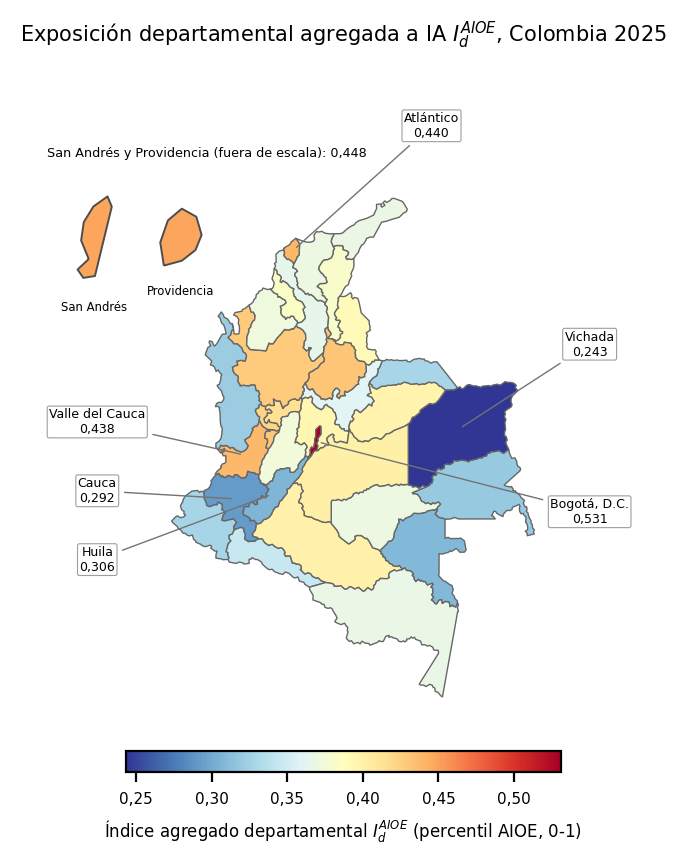

```{python}
#| label: configuracion-publicacion
import sys
from pathlib import Path
sys.path.insert(0, str(Path('../data').resolve()))
from regresiones.validacion.auditoria_qmd_20260926 import publicacion_anexo as pub
import pandas as pd
import numpy as np
from IPython.display import display, Markdown
```

# Introducción {#sec-introduccion}

La inteligencia artificial puede automatizar o complementar tareas dentro de las ocupaciones. Esa distinción, hoy estándar en la literatura, es la que permite medir "exposición" sin necesidad de observar primero el desplazamiento laboral que supuestamente produce. Bajo ese enfoque de tareas, un volumen creciente de evidencia internacional, regional y colombiana ha intentado responder qué tan expuesto está el trabajo humano a la IA, y con qué consecuencias. Este documento se inserta en esa literatura y aporta, específicamente para Colombia, una integración de encuestas de hogares para contrastar índices de exposición con condiciones laborales transferidas desde GEIH y con acceso digital y uso de IA reportados en ECV.

## Evidencia global

El índice de referencia de este documento, AIOE, relaciona las capacidades de distintas aplicaciones de IA con las habilidades requeridas por cada ocupación [@felten2021occupational]. Se usan como contraste el índice de exposición a IA basado en patentes de @webb2020impact y la variante GPT-4 beta de @eloundou2023gpts. Esta última suma a la exposición directa la mitad de la exposición que requiere software adicional. Los tres índices miden exposición potencial. Esta familia de índices se inscribe en la literatura sobre cambio técnico y empleo. @autordorn2013 documentan la polarización del empleo estadounidense entre ocupaciones de alta y baja cualificación. En la versión estática del modelo de @acemoglurestrepo2018, con capital fijo y tecnología exógena, la automatización reduce el empleo y la participación del trabajo en el ingreso, y también puede reducir los salarios. @acemoglurestrepo2022 vinculan el desplazamiento de tareas por la automatización con el aumento de la desigualdad salarial en Estados Unidos.

La evidencia internacional distingue exposición potencial de resultados observados. @frankahnmoro2025 analizan datos ocupacionales de desempleo en Estados Unidos entre 2010 y 2020 y encuentran que los índices individuales tienen capacidad predictiva limitada, mientras su combinación mejora la predicción. Este hallazgo no implica que el coeficiente de AIOE sea necesariamente cero en cualquier especificación. @humlumvestergaard2025 vinculan encuestas de adopción de IA con registros administrativos daneses y estiman efectos medios pequeños sobre ingresos y horas en el corto plazo, junto con reorganización de tareas. Su resultado corresponde a otro contexto y no valida las restricciones de identificación de este documento.

Las mediciones agregadas también requieren distinguir susceptibilidad de desplazamiento. @cazzaniga2024genai estiman que cerca del 40 % del empleo mundial está expuesto a la IA, con diferencias importantes entre grupos de países. En un modelo basado en tareas, @acemoglu2024simplemacro obtiene una ganancia de productividad total de los factores no superior al 0,66 % en diez años bajo su calibración de referencia. Esa cifra no es un pronóstico para Colombia. @jones2026aieconomicfuture destaca que las tareas difíciles de automatizar pueden limitar los aumentos agregados de productividad, mientras @demirer2026emergingmarket documentan la expansión y la caída de precios del mercado de servicios de modelos de lenguaje. Estos trabajos ofrecen mecanismos para interpretar la difusión tecnológica y no tamaños de efecto directamente trasladables a las estimaciones del anexo.

## Evidencia en América Latina

Para la región, @ilowb2024 encuentran que entre 26% y 38% del empleo en América Latina y el Caribe está expuesto a la IA generativa, con diferencias de exposición por composición del empleo y barreras de acceso digital que pueden limitar sus beneficios. Esa relación descriptiva no demuestra que la informalidad cause una menor exposición. @azuararipanitorres2024 aplican la metodología de @eloundou2023gpts a Chile, México y Perú y encuentran que, con un umbral bajo de exposición de tareas (10%), entre 74% y 76% de los empleos quedan expuestos, pero esa proporción cae a entre 6% y 20% con un umbral más exigente (40%); la exposición se concentra en mujeres, trabajadores con educación universitaria, empleo formal e ingresos más altos, lo que podría ampliar la desigualdad laboral regional en vez de reducirla. @ciaschietal2025, combinando cuatro índices de exposición sobre encuestas de hogares de catorce países latinoamericanos, documentan la misma heterogeneidad, y proyectan que, sin políticas mitigadoras, el desplazamiento asociado produciría aumentos moderados, no abruptos, en pobreza y desigualdad.

## Evidencia en Colombia

Las estimaciones colombianas de riesgo de automatización difieren por metodología y año de referencia. @moralespantoja2023 aplican probabilidades de automatización a la GEIH de 2019 y sitúan cerca del 37 % de los empleos en la categoría de alto riesgo. @fernandezsuescun2023 obtienen una proporción cercana al 57 % y muestran que la comparación entre empleo formal e informal depende de la medida utilizada. @mejiapabon2023 estiman un riesgo cercano al 58 % para Colombia en su comparación andina. Estas cifras describen susceptibilidad técnica bajo determinados supuestos, no pérdidas de empleo observadas, y no son directamente equivalentes a los índices de exposición a IA empleados en este documento.

La literatura también estudia ajustes laborales efectivamente observados. @bonilla2022automation encuentran que durante la pandemia el empleo asalariado y las vacantes cayeron más y se recuperaron más lentamente en ocupaciones con mayor potencial de automatización. @medinaposso2018 documentan cambios en la composición ocupacional compatibles con polarización y cambio técnico. En el plano de política pública, @dnp2019conpes3975 y @dnp2025conpes4144 plantean la necesidad de fortalecer capacidades digitales y preparar el mercado laboral para la transformación tecnológica. Estos antecedentes motivan distinguir exposición potencial, acceso digital y uso reportado de IA al analizar sus relaciones con los resultados laborales.

## Aporte de este documento

Este documento pretende analizar la relación entre tecnología y resultados laborales en Colombia, contribuyendo a la literatura mediante el contraste entre exposición ocupacional a la inteligencia artificial, uso reportado de estas herramientas y acceso conjunto a computador e internet. Busca dar respuesta a la pregunta ¿cómo se relacionan estas dimensiones tecnológicas con el ingreso laboral, el desempleo y la no cotización pensional? Su aporte consiste en reunir información laboral y de condiciones de vida para examinar estas relaciones desde perspectivas individuales, territoriales y de cohortes, distinguiendo exposición potencial de acceso y uso observados.

Para ello se presenta una integración de GEIH y ECV mediante imputación por vecino más cercano, con evaluación de su coherencia y limitaciones, y se asignan índices internacionales a las ocupaciones colombianas. Sobre esta base se construye un panel sintético y se aplican diferencias en diferencias, triples diferencias, exposición territorial, efectos fijos y diferencias largas para 2021–2025, junto con un panel de TIC ampliado a 2018–2025. La estrategia se complementa con DML-DiD, un ejercicio instrumental sobre uso reportado de IA en 2025 y un análisis exploratorio de heterogeneidad, diferenciando asociaciones estadísticas de efectos causales identificados.

Los resultados no muestran una asociación persistente de AIOE con ingreso y no cotización. En desempleo aparecen asociaciones negativas en algunos modelos de cohorte, pero el placebo significativo del DML-DiD limita su interpretación causal. El ejercicio instrumental presenta una primera etapa débil. La calibración detecta una señal predictiva de heterogeneidad en desempleo, con evidencia imprecisa para ingreso y no cotización. En el panel de TIC, 10 puntos porcentuales más en la proporción de personas de una misma cohorte que usan computador y viven en un hogar con internet, según la ECV, se asocian con un ingreso laboral real medio imputado 4,66 % mayor y una tasa de no cotización pensional imputada 3,39 puntos porcentuales menor. Ambas asociaciones son significativas con el bootstrap por departamento. La asociación con desempleo no alcanza significancia al 5 %.

El documento se organiza en siete secciones. Después de esta introducción, la Sección 2 presenta la integración de las encuestas, la construcción de los índices y el panel sintético. La Sección 3 describe la distribución de la exposición tecnológica y las condiciones laborales en 2025. La Sección 4 desarrolla las estimaciones clásicas y el panel de TIC, mientras la Sección 5 incorpora aprendizaje automático para examinar exposición, uso reportado de IA y heterogeneidad. La Sección 6 integra los resultados y sus implicaciones económicas. Finalmente, la Sección 7 sintetiza las limitaciones y documenta la reproducción de los análisis, seguida de un apéndice territorial y las referencias.

## Datos: imputación estadística y panel sintético

Ninguno de los dos insumos usados, GEIH y ECV, sigue a las mismas personas en el tiempo ni contiene, por separado, toda la información necesaria: la GEIH aporta detalle laboral; la ECV, condiciones de vida y acceso tecnológico. El documento no construye un panel real, uno que requeriría observar repetidamente a los mismos individuos, sino que transfiere, mediante imputación estadística, atributos entre personas estadísticamente comparables de ambas encuestas, sin enlazar identidades. @dorazio2006statistical y @ridder2007econometrics fundamentan esa combinación de fuentes bajo un supuesto de independencia condicional que se declara de forma explícita y se examina indirectamente mediante diagnósticos de soporte, coherencia y validación reservada. Esos diagnósticos no demuestran el supuesto. Sobre esa base integrada, los registros se agrupan por departamento, sexo y generación de nacimiento para construir un pseudo-panel de cohortes observables en cortes sucesivos, con una ventana principal de estimación de 2021 a 2025 y una extensión de TIC de 2018 a 2025, siguiendo el marco de @deaton1985panel y @verbeek2008pseudopanels: cada "individuo" del panel es, en realidad, la media de una cohorte, no una persona rastreada en el tiempo. Esta distinción, imputación en lugar de enlace real y panel sintético en lugar de panel verdadero, es la limitación metodológica más importante del documento, y se discute en detalle, con sus consecuencias para la varianza estimada, en el Capítulo 2.

La estrategia conserva AIOE como índice de referencia para los tres resultados laborales, desempleo, no cotización pensional e ingreso, mientras Webb-IA y LLM se estiman en regresiones separadas sobre muestras comparables, en vez de combinarse en un único indicador: este diseño permite comparar las asociaciones de cada indicador con los resultados, sin que quede oculto dentro de un índice compuesto. Software y robots se incorporan como extensiones del mismo ejercicio, y la envolvente máxima que resume los tres índices principales en un solo valor se calcula únicamente como ejercicio de sensibilidad, no como sustituto de los indicadores específicos. AIOE se mantiene como referencia común para facilitar la comparación entre especificaciones.

La reproducibilidad numérica, la validez descriptiva de la integración y la identificación econométrica son dimensiones distintas. La coincidencia de cálculos no prueba independencia condicional ni causalidad. Por ello, las regresiones se interpretan como asociaciones condicionadas a su diseño y no como efectos causales demostrados. Los códigos de procesamiento, emparejamiento, construcción de índices y estimación se documentan en las carpetas de reproducción del proyecto.

# Integración de datos, exposición tecnológica y pseudo-panel {#sec-integracion}

Este capítulo describe cómo se construye la base de datos que sustenta el resto del documento. Primero se presenta el emparejamiento estadístico entre la GEIH y la ECV: su fundamento teórico, las reglas de armonización y transferencia entre encuestas, el criterio de distancia utilizado para asignar donantes y los resultados de esa integración, incluida su evaluación de coherencia y sus límites. Segundo, se explica la construcción de los índices de exposición tecnológica, AIOE, Webb–IA, LLM, software y robots: su fundamento, la forma en que se asignan a las ocupaciones colombianas, su normalización en escala fija, la muestra común exigida para compararlos y el procedimiento para agregarlos a nivel departamental y de cohorte. Tercero, se describe el pseudo-panel: la definición de cohortes por departamento, sexo y generación aproximada de nacimiento, el cálculo de sus medias y los resultados de su construcción y evaluación. En conjunto, estas tres secciones documentan el origen de los datos y de las variables de exposición que se utilizan en las estimaciones econométricas presentadas más adelante.

## Emparejamiento de cortes transversales GEIH–ECV {#sec-matching}

Esta sección detalla el emparejamiento estadístico entre GEIH y ECV. Presenta primero su fundamento teórico y el supuesto de independencia condicional que lo sustenta; luego describe los universos, la armonización de variables y las reglas de transferencia entre encuestas; a continuación explica el criterio de distancia utilizado para seleccionar al donante y la forma en que se preserva la coherencia dentro del hogar; después reporta los resultados numéricos de la integración; y finalmente evalúa su coherencia interna y sus límites mediante contrastes distributivos y validación laboral retrospectiva.

### Fundamento teórico y supuestos

El emparejamiento estadístico combina información de dos encuestas mediante características comunes. Sean $L$ los atributos laborales que se transfieren desde GEIH, $B$ los atributos de bienestar conservados de ECV y $C$ las características usadas para comparar personas, como edad, sexo, educación y región. Incluso entre personas con el mismo $C$, los ingresos y las condiciones de bienestar pueden ser distintos. Hablar de distribuciones permite representar esa diversidad. Las funciones $f(L\mid C)$ y $f(B\mid C)$ describen cómo se distribuyen esos atributos entre personas comparables. Cada encuesta permite aproximar su distribución con la muestra y los factores de expansión, pero las dos fuentes por separado no identifican la distribución conjunta completa $f(L,B\mid C)$.

El vecino más cercano es el mecanismo operativo de imputación. Dentro de los bloques admisibles, selecciona un donante de GEIH con características próximas a las del receptor de ECV y transfiere sus atributos laborales observados. Las funciones $f$ describen cómo se distribuyen los atributos entre personas comparables. El algoritmo no calcula esas funciones para elegir al donante, sino que selecciona a la persona más cercana según las características comunes $C$. Al transferir conjuntamente sus atributos laborales, conserva una combinación observada en GEIH. Sin embargo, como algunos donantes se utilizan más que otros, la frecuencia de esas combinaciones puede cambiar en la base integrada.

Como explican @rassler2002statistical y @dorazio2006statistical, conocer las dos distribuciones por separado no determina cómo se relacionan $L$ y $B$ dentro de cada grupo definido por $C$. Para identificar esa relación, el documento supone que los atributos laborales $L$ y los atributos de bienestar $B$ son condicionalmente independientes, $(L\perp B)\mid C$. Esto significa que, entre personas con las mismas características $C$, conocer $B$ no aporta información adicional sobre $L$, y conocer $L$ tampoco la aporta sobre $B$. El supuesto permite seleccionar al donante sin utilizar los atributos exclusivos $B$ del receptor. Bajo esta condición, la distribución conjunta objetivo se expresa como

$$f(L,B\mid C)=f(L\mid C)f(B\mid C).$$

La independencia condicional se refiere a personas con el mismo $C$, no a toda la población. Para atributos numéricos con segundos momentos finitos, implica $\operatorname{Cov}(L,B\mid C)=0$, aunque una covarianza nula no basta para demostrar independencia. La covarianza no condicionada resume la asociación lineal entre ambos atributos en la población y puede seguir siendo distinta de cero. La ley de covarianza total explica por qué

$$\operatorname{Cov}(L,B)=E\{\operatorname{Cov}(L,B\mid C)\}
+\operatorname{Cov}\{E(L\mid C),E(B\mid C)\}.$$

El primer término recoge la asociación dentro de grupos con el mismo $C$ y el segundo, la asociación entre sus medias. Por ejemplo, los grupos con mayor educación pueden tener tanto mayores ingresos como mayor acceso a internet, aunque no exista una relación adicional entre ambos atributos dentro de cada grupo. Las encuestas permiten aproximar el segundo término, pero no identificar el primero para atributos que no se observan conjuntamente. Bajo independencia condicional, el primer término se supone igual a cero. Esta distinción importa al analizar la base integrada porque la asociación entre un atributo transferido de GEIH y otro conservado de ECV puede reflejar las diferencias asociadas con $C$, sin demostrar una relación adicional dentro de los grupos. Esta es una propiedad del modelo supuesto; el emparejamiento aproximado y la muestra finita no garantizan que se cumpla exactamente en la base imputada.

La integración requiere además mediciones comparables, representatividad de las encuestas, donantes suficientemente próximos y transportabilidad, es decir, que la información laboral de los donantes sea pertinente para receptores comparables. Se selecciona una ventana de la GEIH que busca reducir las diferencias estacionales mediante el solapamiento con los periodos de recolección de la ECV. Sin embargo, estos periodos no coinciden plenamente en todos los años, por lo que pueden persistir diferencias estacionales entre ambas encuestas. Los diagnósticos permiten evaluar si el emparejamiento produce resultados coherentes y plausibles, pero no prueban la independencia condicional. Interpretar las relaciones entre atributos de ambas encuestas requiere ese supuesto u otra condición identificadora. Los valores transferidos fueron observados en los donantes de GEIH, pero son imputados para los receptores de ECV y pueden diferir de sus valores reales.

### Universos, armonización y reglas de transferencia

La colección oficial reúne 2018–2025 y alimenta las estimaciones y el dashboard mediante un registro común de rutas e indicadores. En 2018–2020 se emplean fuentes históricas armonizadas y, desde 2021, la clasificación ocupacional de marco 2018. Los campos no disponibles permanecen ausentes. En 2020 se excluyen donantes sin parentesco o actividad requeridos. En 2021, la ausencia estructural de actividad de menores de 15 años no se trata como una omisión adulta; se conserva la versión compatible con los modelos ocupacionales. Estas adaptaciones mantienen la distancia y las reglas de transferencia, pero no convierten las encuestas de distintos años en instrumentos idénticos.

El conjunto $C$ reúne las características comunes utilizadas para comparar personas de GEIH y ECV. Incluye departamento, zona, sexo, edad, educación, jefatura del hogar, tamaño del hogar, pertenencia a la población en edad de trabajar y actividad principal. Departamento, zona y sexo delimitan los bloques de búsqueda inicial, mientras las demás características permiten seleccionar al donante más cercano dentro de cada bloque. La población en edad de trabajar comprende a las personas de 15 años o más.

La educación se armoniza en cinco categorías que comprenden sin educación o preescolar, primaria, secundaria o media, técnica o tecnológica, y universitaria o posgrado. En la ECV se respetan las rutas de respuesta de quienes asisten y no asisten a instituciones educativas, y en la GEIH la Escuela Normal Superior se incluye en secundaria o media. Los datos ausentes se conservan y no se interpretan como ausencia de educación.

La condición de ocupado o desocupado se transfiere desde el donante y se restringe a la población en edad de trabajar. Trabajar como actividad principal orienta el emparejamiento, pero no identifica a todos los ocupados. La tasa de desempleo divide los desocupados entre la suma de ocupados y desocupados. La no cotización pensional se mide entre ocupados con respuesta válida, excluyendo pensionados, y no equivale a la informalidad oficial. El análisis logarítmico del ingreso incluye únicamente valores positivos. La habilitación tecnológica combina uso individual de computador e internet del hogar, sin representar adopción de IA.

La pobreza y el ingreso per cápita proceden del donante del jefe receptor y se comparten entre los integrantes del hogar. Si no existe un jefe único identificable, permanecen ausentes. Un dato de pobreza desconocido no se convierte en ausencia de pobreza. Al ponderar estos indicadores entre personas, los resultados describen población que vive en esa condición, no proporciones de hogares.

### Distancia, selección del donante y coherencia del hogar

Dentro de los bloques definidos previamente, se comparan las seis características restantes de $C$ mediante distancia euclidiana, siguiendo el enfoque hot deck por vecino más cercano descrito por @dorazio2006statistical y revisado por @andridge2010hotdeck. Las escalas y los pesos se fijan para este estudio. La edad se divide entre 100 y la educación, codificada de cero a cuatro, entre cuatro. El tamaño del hogar se acota entre uno y quince integrantes y se divide entre diez. Los indicadores de jefatura, pertenencia a la población en edad de trabajar y trabajar como actividad principal toman valores de cero o uno y se multiplican por dos, cinco y tres, respectivamente, para priorizar esas coincidencias. La edad no tiene tope y su coordenada supera la unidad en mayores de cien años. Así se obtiene el vector de comparación para cada persona $i$

$$z_i=\left(\frac{\text{edad}_i}{100},\frac{\text{educ}_i}{4},2\,\text{jefe}_i,
\frac{\max\{1,\min(\text{tamhogar}_i,15)\}}{10},5\,\text{PET}_i,3\,\mathbb{I}(\text{trabaja}_i=1)\right).$$

En esta expresión, $\text{PET}$ indica pertenencia a la población en edad de trabajar y $\mathbb{I}$ identifica trabajar como actividad principal. Se selecciona al donante que minimiza la distancia entre las características disponibles. Un mismo donante puede atender a varios receptores. Si falta educación en el receptor, se omite esa dimensión. Si está observada, se buscan donantes con educación disponible y solo se omite cuando ninguno dispone de ella. Las demás características deben ser válidas. Para el conjunto de donantes admisibles $\mathcal D(i)$ y las dimensiones utilizables $K_i$, la selección y la transferencia se expresan como

$$j^*(i)=\arg\min_{j\in\mathcal D(i)}\left[\sum_{k\in K_i}(z_{ik}-z_{jk})^2\right]^{1/2},
\qquad \widehat L_i=L_{j^*(i)}.$$

Aquí $j^*(i)$ identifica al donante elegido y $\widehat L_i$ representa los atributos laborales imputados al receptor. La búsqueda comienza dentro del mismo departamento, zona y sexo. Si no hay donantes, se amplía a otros departamentos conservando zona y sexo, sin exigir cercanía geográfica. Si tampoco se encuentran candidatos, el procedimiento se detiene. Los empates dependen del orden de los donantes y su sensibilidad se evalúa mediante un vecino alternativo a igual distancia. Los atributos laborales se transfieren conjuntamente desde el donante elegido. La pobreza y el ingreso per cápita proceden del donante del jefe receptor y se asignan a todos los integrantes del hogar. Para un atributo de hogar $Q$ y un jefe receptor único $h$, la regla es

$$\widehat Q_i=Q_{j^*(h)}.$$

Si no se identifica un jefe único, estos valores permanecen ausentes. Su igualdad dentro del hogar es una regla impuesta y no constituye una validación externa. En la extensión histórica, estos atributos permanecen ausentes cuando no existen insumos GEIH comparables; el ingreso per cápita original de ECV no se presenta como si hubiera sido transferido. Los ingresos se expresan a precios de octubre de 2025 multiplicando su valor nominal por el cociente entre el índice de precios al consumidor de referencia y el correspondiente al año de origen. El valor de referencia es 151,76, con diciembre de 2018 igual a 100, según @dane2025ipc. Esta conversión permite comparar valores monetarios, pero no corrige diferencias estacionales ni de composición. El ajuste se expresa como

$$w_{it}^{real}=w_{it}^{nom}\frac{IPC_{2025}}{IPC_t}.$$

### Resultados de la integración transversal

La @tbl-fuentes-matching presenta las fuentes y los registros integrados de la colección común entre 2018 y 2025. GEIH original cuenta los registros del ensamblaje donante y GEIH admisible aquellos que cumplen las reglas requeridas para seleccionar vecinos. Las exclusiones históricas de donantes por parentesco o actividad se distinguen de las exclusiones territoriales de ECV. Los receptores son las personas de ECV integradas y los donantes utilizados son personas distintas de GEIH, reutilizables para varios receptores. En 2021 se utiliza la versión de marco 2018 con actividad laboral desde los 15 años, común a las estimaciones individuales y al panel de TIC. Las cifras anteceden a los filtros de cada regresión.

```{python}
#| label: tbl-fuentes-matching
#| tbl-cap: "Fuentes originales, donantes admisibles y registros integrados, 2018–2025."
pub.mostrar(pub.fuentes())
```

La @tbl-matching-resultados presenta las tasas imputadas de desempleo y no cotización, calculadas en sus respectivos universos laborales y ponderadas con los factores de expansión de ECV. La ampliación mide el porcentaje ponderado de receptores que necesitó un donante de otro departamento. Los usos medios y máximos indican el promedio y el mayor número de receptores atendidos por un mismo donante. Su reutilización genera dependencia entre receptores, por lo que estos no equivalen a observaciones laborales independientes. Estos indicadores describen el alcance de la integración, pero no demuestran por sí solos su validez.

```{python}
#| label: tbl-matching-resultados
#| tbl-cap: "Tasas ponderadas imputadas y concentración de utilización de donantes."
pub.mostrar(pub.matching())
```

### Evaluación posterior: coherencia y límites

La transferencia conjunta conserva la combinación de atributos laborales observada en el donante, pero el vecino más cercano no necesariamente comparte las condiciones laborales reales del receptor. Además, la selección y reutilización de donantes pueden cambiar la frecuencia de esas combinaciones. La evaluación distingue los diagnósticos básicos comparables de 2018–2025 de las validaciones más detalladas de 2022–2025, cuyo cuestionario y correspondencias están documentados. La disponibilidad histórica de campos determina qué comprobaciones pueden realizarse sin inventar equivalencias.

La @tbl-coherencia-matching presenta las comprobaciones internas disponibles en los ocho años. Los guiones indican diagnósticos no calculables por ausencia de atributos comparables, no resultados iguales a cero. En ese año, el 99,95 % de quienes declararon trabajar como actividad principal quedó clasificado como ocupado y ambas clasificaciones coincidieron en el 92,97 % de las personas de 15 años o más. Este acuerdo es parcialmente esperado porque la actividad principal ayuda a elegir al donante. En ningún año se asignó condición de ocupado o ingreso laboral positivo a menores de 15 años, ni ingreso laboral positivo a personas clasificadas como desocupadas. Entre los ocupados imputados, los códigos ocupacionales ausentes o inválidos fueron 30, 3, 2 y 0 en 2022, 2023, 2024 y 2025, respectivamente. Las correlaciones entre ingreso per cápita transferido y registrado en ECV fueron 0,262, 0,274, 0,287 y 0,327. Son asociaciones positivas limitadas, no porcentajes de acierto. Los porcentajes y las correlaciones de esta tabla no utilizan factores de expansión. La correlación incluye personas con ingreso ECV positivo y ambos valores observados, repitiendo el ingreso del hogar por integrante, por lo que no equivale a una comparación entre hogares únicos.

```{python}
#| label: tbl-coherencia-matching
#| tbl-cap: "Coherencia interna y restricciones contables disponibles, 2018–2025."
pub.mostrar(pub.coherencia())
```

La @tbl-evaluacion-laboral compara la condición de ocupado imputada con la reconstruida mediante varias respuestas laborales de ECV, no solo la actividad principal. A diferencia de la @tbl-coherencia-matching, utiliza factores de expansión y personas con clasificación laboral reconstruida válida, por lo que sus porcentajes no son directamente equivalentes. Se comparan la variante de seis dimensiones, denominada 6D, que incluye la actividad principal, y la de cinco dimensiones, denominada 5D, que la excluye. Los verdaderos positivos y negativos, $VP$ y $VN$, representan aciertos al identificar ocupados y no ocupados; los falsos positivos y negativos, $FP$ y $FN$, representan errores en esas clasificaciones. Estas cantidades son totales ponderados y $N$ es su suma. La sensibilidad, $VP/(VP+FN)$, mide la proporción de ocupados correctamente identificados; la especificidad, $VN/(VN+FP)$, la de no ocupados correctamente identificados; y el acuerdo global, $(VP+VN)/N$, la proporción total de coincidencias. Las tres medidas se expresan en porcentaje.

Como la actividad principal interviene en la selección del donante y en la reconstrucción laboral, la evaluación de 6D es parcialmente interna. La variante 5D examina esa dependencia en una comparación retrospectiva, no en una validación ciega. En 2023, la sensibilidad, la especificidad y el acuerdo global de 6D alcanzan 93,00 %, 86,91 % y 90,38 %, frente a 74,40 %, 61,13 % y 68,68 % con 5D. La disminución muestra cuánto depende la reconstrucción de la actividad principal. La última columna mide la proporción de ocupados según ECV cuya actividad principal no es trabajar que la imputación identifica como ocupados, por ejemplo, estudiantes que también trabajan. En 2023, 6D reconoce al 21,01 % de este grupo, aproximadamente 21 de cada 100. Esta baja recuperación revela una limitación que el elevado acuerdo global puede ocultar.

```{python}
#| label: tbl-evaluacion-laboral
#| tbl-cap: "Reconstrucción laboral ponderada: distancia 6D y sensibilidad sin actividad principal, 5D."
pub.mostrar(pub.validacion_laboral().rename(columns={
    'Recuperación de ocupados con otra actividad principal %':
    'Recuperación de ocupados<br>con otra actividad principal %'
}))
```

La @tbl-variables-reserva compara la afiliación pensional, la posición ocupacional y las horas imputadas con las declaradas en ECV, variables no utilizadas para elegir al donante. En cada año se selecciona de forma reproducible aproximadamente una quinta parte de los hogares y se exige ocupación en ambas fuentes y respuestas comparables. En 2023 quedan 18.743 personas para pensiones y horas y 18.738 para posición ocupacional, con una cobertura ponderada cercana al 93,28 % de los ocupados del grupo seleccionado. En los cuatro años, coinciden aproximadamente 65 de cada 100 personas en afiliación pensional y entre 48 y 50 en posición ocupacional. El error absoluto medio es de 12,41 a 13,00 horas semanales. Los sesgos positivos, de 1,96 a 3,27 horas, indican sobreestimación promedio y pueden coexistir con errores individuales mayores. Los indicadores están ponderados y describen únicamente al grupo evaluado. La selección de hogares no constituye por sí sola una validación ciega previa.

```{python}
#| label: tbl-variables-reserva
#| tbl-cap: "Variables excluidas de la distancia en hogares seleccionados, 2022–2025, método 6D."
pub.mostrar(pub.reservadas())
```

Siguiendo los diagnósticos distributivos descritos por @dorazio2013matching, la @tbl-hellinger compara las proporciones ponderadas de características comunes en GEIH y ECV originales para cada año. Se presenta como diagnóstico complementario de comparabilidad entre fuentes, no como evaluación directa de los atributos imputados. Se utiliza la afinidad de Hellinger entre las distribuciones $P$ y $Q$, donde $p_j$ y $q_j$ son las proporciones de la categoría $j$ y suman uno en cada distribución. La medida se calcula mediante

$$\rho(P,Q)=\sum_j\sqrt{p_jq_j},\qquad 0\leq\rho\leq1.$$

La afinidad vale uno cuando las proporciones coinciden en todas las categorías y disminuye cuando difieren. Por ejemplo, en 2023 la proporción ponderada de hombres es 48,67 % en GEIH y 48,72 % en ECV original. Al incluir también las proporciones de mujeres se obtiene $\rho=\sqrt{0{,}4867\times0{,}4872}+\sqrt{0{,}5133\times0{,}5128}\approx1{,}0000$. En los cuatro años, las afinidades de zona, sexo, tramos de edad, jefatura y pertenencia a la población en edad de trabajar redondean a 1,0000. Para educación oscilan entre 0,9979 y 0,9986. Estos valores describen semejanza en las características comunes, no en las relaciones entre variables exclusivas de ambas encuestas. El umbral de 0,95, cuando se utiliza, es descriptivo.

```{python}
#| label: tbl-hellinger
#| tbl-cap: "Afinidad marginal ponderada entre GEIH y ECV originales, 2022–2025."
pub.mostrar(pub.hellinger())
```

La @fig-densidad compara, para cada año de 2022 a 2025, el ingreso laboral positivo observado en GEIH con el transferido a los receptores de ECV del mismo año. Las distribuciones se ponderan con los factores de cada encuesta y se presentan en logaritmos y a precios de octubre de 2025. Aunque los valores proceden de GEIH, su frecuencia puede cambiar por la selección y reutilización de donantes y los factores de ECV. El ingreso no interviene en la distancia $z_i$ utilizada para elegir al donante. Las curvas cercanas en los cuatro años muestran semejanza agregada, no precisión del ingreso asignado a cada receptor. Se excluyen valores cero y ausentes. Este diagnóstico de ingreso laboral es distinto de las correlaciones de ingreso per cápita de la @tbl-coherencia-matching.

{#fig-densidad width=100%}

La @tbl-tasas-comparadas compara la tasa de desempleo de la muestra donante de GEIH con la calculada para los receptores de ECV después de asignarles la condición de ocupado o desocupado de sus donantes. En ambos casos se divide el total ponderado de desocupados entre el de ocupados y desocupados, utilizando los factores de expansión de la encuesta correspondiente. En 2022, las tasas son 9,99 % en GEIH y 10,00 % en ECV integrada, mientras que en 2025 alcanzan 7,80 % y 7,25 %. La ampliación histórica muestra una discrepancia mayor en 2018, con 9,14 % en el conjunto donante y 11,53 % en la base integrada, una diferencia de 2,39 puntos porcentuales. Por tanto, la conservación de este agregado no es uniforme en todo el periodo. La cercanía de varias tasas posteriores no constituye una validación independiente ni garantiza coincidencias por departamento o persona. Las diferencias individuales pueden compensarse y producir tasas similares.

```{python}
#| label: tbl-tasas-comparadas
#| tbl-cap: "Desempleo en el conjunto donante e imputado: contraste descriptivo de tasas ponderadas."
pub.mostrar(pub.tasas())
```

La @tbl-empates examina qué cambia al elegir otro donante situado a la misma distancia del receptor. En 2023, el 47,59 % de los receptores tuvo al menos un donante alternativo empatado, aproximadamente 48 de cada 100 registros. Estos receptores representan el 55,07 % de la población estimada con los factores de expansión de ECV. La columna de educación cuenta los casos en que esa característica no se utilizó para calcular la distancia, que fueron 28.515 ese año. Al elegir el donante alternativo, 7.591 personas cambiaron entre ocupado y no ocupado. Sin embargo, la tasa ponderada de ocupación aumentó solo 0,05 puntos porcentuales, porque los cambios en sentidos opuestos se compensan parcialmente. Un cambio positivo en la última columna indica un aumento de la tasa y uno negativo, una disminución. Esta estabilidad agregada no garantiza estabilidad individual ni incorpora la incertidumbre de imputación a los errores estándar de las regresiones.

```{python}
#| label: tbl-empates
#| tbl-cap: "Sensibilidad a otro vecino equidistante: incidencia y cambio de tasa de ocupación."
pub.mostrar(pub.empates())
```

En 2023, los diagnósticos respaldan la coherencia interna y la semejanza de algunos agregados, en línea con los criterios de evaluación distributiva descritos por @dorazio2013matching. Sin embargo, las discrepancias en afiliación pensional, posición ocupacional, horas e ingreso per cápita muestran que transferir atributos reales del donante no garantiza representar las condiciones del receptor. Además, la reconstrucción laboral depende de la actividad principal y reconoce a pocos ocupados cuya actividad principal no es trabajar. Estos resultados respaldan una aproximación sintética de los agregados examinados, no la precisión individual ni la independencia condicional. Su uso en los análisis de exposición tecnológica requiere reconocer esta incertidumbre y evaluar la sensibilidad de las estimaciones a la imputación.

Entre 2018 y 2025 se cumplen las restricciones contables revisadas, aunque la conservación de los agregados laborales varía por año. Las mayores diferencias entre el desempleo imputado y el del conjunto donante aparecen en 2018 y 2019, con 2,39 y 1,20 puntos porcentuales adicionales, respectivamente. Desde 2020, las diferencias absolutas no superan 0,56 puntos. Las validaciones detalladas de 2022–2025 muestran un acuerdo laboral de 90,28 % a 90,47 % con seis dimensiones, que disminuye a 68,16 %–69,86 % al excluir la actividad principal. Los acuerdos pensionales se sitúan entre 64,66 % y 65,43 %, y los de posición ocupacional entre 47,79 % y 49,66 %. El error absoluto medio en horas alcanza 12,41–13,00 horas semanales y las correlaciones de ingreso per cápita, 0,262–0,327. Estos últimos diagnósticos no deben extrapolarse a 2018–2021, donde no se dispone de la misma evaluación detallada ni de todos los atributos comparables. En conjunto, la integración permite estudiar determinados agregados, con mayores reservas para los primeros años, pero no garantiza precisión individual ni valida por sí sola las relaciones con exposición tecnológica.

Los scripts, las instrucciones y los resultados reproducibles de ambos apartados se reúnen en [Evaluación transversal reproducible](../data/regresiones/validacion/evaluacion_transversal/README.md). El procedimiento recalcula los diagnósticos de los cuatro años desde las fuentes y bases integradas existentes, verifica los donantes asignados y conserva sin cambios los microdatos originales.

## Construcción y asignación de los índices de exposición {#sec-indices}

Esta sección describe cómo se construyen y asignan los índices de exposición a la inteligencia artificial que sustentan las estimaciones econométricas posteriores. Se parte de cinco indicadores ocupacionales tomados de la literatura internacional, AIOE, Webb-IA, LLM, software y robots, más una envolvente máxima de sensibilidad, trasladados a las 455 ocupaciones del catálogo CIUO-08 A.C. mediante correspondencias O*NET-SOC, SOC e ISCO-08. Cada indicador se normaliza en una escala percentil fija sobre las ocupaciones con puntuación observada, con una versión Min-Max como sensibilidad de escala, sin recalcularse por año ni por submuestra. La asignación individual depende de la situación laboral, usando la ocupación actual para ocupados y la última ocupación desempeñada para desocupados, y hereda la incertidumbre del emparejamiento descrito en la sección anterior. Finalmente, se explica cómo se define la muestra común comparable entre los cinco índices y cómo el índice individual se agrega a exposición departamental o de cohorte para alimentar cada familia de modelos utilizada más adelante.

### Fundamentos y elección de indicadores

El índice AIOE de @felten2021occupational busca identificar las ocupaciones cuyas habilidades están más expuestas a los avances de la inteligencia artificial. Para ello, relaciona las habilidades requeridas en cada ocupación con las capacidades tecnológicas de la IA. Una mayor puntuación indica mayor exposición potencial, que puede traducirse tanto en sustitución como en complementación del trabajo. Los tres índices de @webb2020impact buscan identificar qué tareas ocupacionales podrían verse afectadas por la IA, el software y los robots, respectivamente. Se construyen comparando las descripciones de las tareas con el lenguaje de las patentes de cada tecnología, de modo que una mayor coincidencia indica mayor exposición. @eloundou2023gpts buscan estimar qué proporción de las tareas de una ocupación podría realizarse en menos tiempo mediante modelos de lenguaje, manteniendo su calidad. La variante GPT-4 beta utilizada aquí combina las tareas expuestas al uso directo del modelo con aquellas que requieren software adicional, ponderando estas últimas a la mitad, $\beta = E_1 + 0{,}5E_2$. Así, los índices distinguen la exposición vinculada con habilidades, tareas y posibilidades de ahorro de tiempo. Ninguno representa una probabilidad de desaparición de la ocupación ni estima por sí solo el impacto sobre el empleo o los salarios.

| Indicador | Campo original | Referencia | Datos | Uso principal en el análisis |
|:---|:---|:---|:---|:---|
| AIOE | `AIOE` | @felten2021occupational | [Consultar](https://github.com/AIOE-Data/AIOE/blob/main/AIOE_DataAppendix.xlsx) | Referencia común para desempleo, no cotización e ingreso |
| Webb–IA | `ai_score` | @webb2020impact | [Consultar](https://www.michaelwebb.co/) | Contraste de exposición a IA basada en patentes |
| LLM | `dv_rating_beta` | @eloundou2023gpts | [Consultar](https://github.com/openai/GPTs-are-GPTs/blob/main/data/occ_level.csv) | Contraste de exposición a modelos de lenguaje |
| Software | `software_score` | @webb2020impact | [Consultar](https://www.michaelwebb.co/) | Extensión de automatización por software |
| Robots | `robot_score` | @webb2020impact | [Consultar](https://www.michaelwebb.co/) | Extensión de automatización robótica |

: Indicadores de exposición a la inteligencia artificial utilizados y su referencia bibliográfica. {#tbl-indicadores-exposicion}

### Correspondencias ocupacionales y asignación individual

La asignación de los indicadores de exposición a la base integrada GEIH–ECV se realiza mediante el código de ocupación transferido desde el donante. Primero se armonizan las clasificaciones ocupacionales de las fuentes internacionales con la clasificación colombiana CIUO-08 A.C. Después se construye un catálogo con las puntuaciones disponibles para cada ocupación y se enlaza con la base integrada. A diferencia del emparejamiento entre personas, este enlace utiliza la coincidencia del código ocupacional y no una distancia entre características. Así, las personas con el mismo código reciben la misma puntuación de cada indicador. Esta asignación representa la exposición potencial de su ocupación, no el uso efectivo de tecnología en su puesto de trabajo.

El catálogo de referencia contiene 455 ocupaciones de la CIUO-08 A.C. Las puntuaciones internacionales se vinculan primero con ISCO-08 mediante las correspondencias entre clasificaciones y luego con los códigos colombianos. De las 455 ocupaciones, 436 tienen correspondencia por código exacto con ISCO-08 y cuatro se aproximan mediante el promedio de las ocupaciones que comparten sus primeros tres dígitos. Esta segunda regla ofrece menor detalle y puede omitir diferencias propias de la clasificación colombiana. Las 15 restantes carecen de correspondencia en el catálogo utilizado. Cuando varios códigos internacionales corresponden a una misma ocupación, sus puntuaciones se promedian sin ponderación por empleo. Tener correspondencia no garantiza disponer de todos los indicadores, pues también se requiere una puntuación en la fuente original. Los valores no disponibles se mantienen ausentes, sin sustituirlos por cero ni por el promedio nacional.

Para enlazar este catálogo con la base integrada, se utiliza la ocupación correspondiente a la situación laboral transferida desde GEIH, según las definiciones de su diccionario oficial de @dane2023diccionario. A los ocupados se les asigna la exposición de su ocupación actual y a los desocupados, la de su última ocupación, suponiendo que esta representa su exposición tecnológica relevante. Como análisis de sensibilidad, para los desocupados se utiliza la ocupación buscada en lugar de la anterior. Esta alternativa se evalúa por separado y no se emplea para completar códigos ausentes en la asignación principal. Si falta el código correspondiente o la puntuación de esa ocupación, la persona queda sin ese indicador.

Estas reglas delimitan el alcance del análisis. Las estimaciones de exposición ocupacional abarcan 2021–2025 porque las bases armonizadas de 2018–2020 no disponen de códigos ocupacionales comparables que permitan asignar los cinco indicadores. El panel de acceso a computador e internet sí comprende 2018–2025. En las estimaciones clásicas de desempleo de 2021–2025, la muestra común retiene 541.805 de 573.501 observaciones disponibles, el 94,47 %, después de exigir exposición en los cinco indicadores y controles válidos. Las 31.696 observaciones restantes, el 5,53 %, quedan fuera por esas restricciones y no exclusivamente por falta de ocupación. Entre las personas sin exposición identificable pueden encontrarse quienes buscan su primer empleo y carecen de ocupación previa. La exposición asignada conserva la incertidumbre del emparejamiento GEIH–ECV, pues procede de la ocupación del donante. Para LLM, la aplicación a años anteriores a su evaluación representa exposición potencial a esas capacidades, no uso efectivo de las herramientas en ese momento.

La @tbl-referencia-indices presenta cuántas de las 455 ocupaciones del catálogo colombiano tienen puntuación disponible para cada indicador y resume sus valores normalizados por percentiles. Este procedimiento se explica en la sección siguiente, mientras que la normalización por mínimo y máximo se utiliza únicamente como análisis de sensibilidad. La tabla describe un catálogo ocupacional fijo, utilizado para asignar exposición en las bases de 2021–2025, y no resultados de un año específico de GEIH o ECV. AIOE, IA de Webb, software y robots tienen información para 426 ocupaciones, mientras que LLM cubre 396. En los cinco indicadores, la media es 0,5 y la desviación estándar se aproxima a 0,29. Esta similitud responde a la normalización de los rangos entre 0 y 1 y no implica que los indicadores asignen la misma exposición a cada ocupación.

```{python}
#| label: tbl-referencia-indices
#| tbl-cap: "Disponibilidad y distribución de los índices en el catálogo ocupacional fijo."
pub.mostrar(pub.referencia_indices())
```

### Normalización fija y sensibilidad de escala

Para cada indicador $k$, se ordenan de menor a mayor las puntuaciones originales de las $N_k$ ocupaciones con información disponible. La puntuación de la ocupación $o$ se denota por $S_o^k$, y su posición por $r_o^k$. Se utiliza una normalización por rangos consistente con las posiciones relativas de la definición de cuantiles tipo 7 descrita por @hyndman1996sample. En este estudio, los empates reciben el rango promedio. La exposición normalizada se calcula mediante

$$I_o^{k,P}=\frac{r_o^k-1}{N_k-1}.$$

Restar uno al rango y dividir entre $N_k-1$ permite expresar la posición relativa de cada ocupación en una escala de cero a uno. Sin empates, la ocupación con menor puntuación recibe cero y la de mayor puntuación recibe uno. Este valor indica su posición en el ordenamiento, no una probabilidad de automatización. Cuando varias ocupaciones tienen la misma puntuación, se les asigna el promedio de los puestos que ocuparían, por lo que los extremos empatados pueden no alcanzar cero o uno. Cada ocupación tiene el mismo peso, independientemente de su número de trabajadores, y la normalización se mantiene fija para todos los años, resultados laborales y submuestras, tanto al asignar el índice a personas como al agregarlo.

Un ejemplo del catálogo ilustra el cálculo. La ocupación 2512, desarrolladores de software, tiene una puntuación original de AIOE de 1,242115 y ocupa el puesto 386 entre las 426 ocupaciones con información disponible. Por tanto, $I_o^{AIOE,P}=(386-1)/(426-1)=385/425\approx 0{,}9059$. Para ilustrar los empates, cuatro ocupaciones comparten la puntuación original de 0,9646872 y ocupan conjuntamente los puestos 324, 325, 326 y 327. Todas reciben el rango promedio de 325,5 y el mismo valor normalizado, $I_o^{AIOE,P}=(325{,}5-1)/425\approx 0{,}7635$.

Como análisis de sensibilidad, se aplica también la normalización por mínimo y máximo. Esta transforma la puntuación original de cada ocupación a una escala de cero a uno según su distancia respecto de los valores extremos del indicador. A diferencia de la normalización por rangos, conserva las distancias relativas entre las puntuaciones originales. Se calcula mediante

$$I_o^{k,MM}=\frac{S_o^k-\min_o S_o^k}{\max_o S_o^k-\min_o S_o^k}.$$

La normalización por percentiles refleja la posición de cada ocupación en el ordenamiento, mientras que la normalización por mínimo y máximo considera la distancia de su puntuación respecto de los extremos. Ambas utilizan una escala de cero a uno, pero no hacen equivalentes los conceptos medidos por los indicadores. Para la ocupación 2512, desarrolladores de software, la puntuación original de AIOE es 1,242115. Entre las 426 ocupaciones con información, el mínimo es −2,1227635 y el máximo es 1,446232. El valor normalizado se obtiene mediante

$$
I_o^{AIOE,MM}
=\frac{1{,}242115+2{,}1227635}{1{,}446232+2{,}1227635}
\approx 0{,}9428.
$$

Este resultado sitúa la puntuación al 94,28 % del recorrido entre el mínimo y el máximo, no por encima del 94,28 % de las ocupaciones. Como medida complementaria, la envolvente toma el mayor valor entre AIOE, IA de Webb y LLM, calculados en una misma escala. Se define mediante

$$I_o^{max}=\max\{I_o^{AIOE},I_o^{WebbIA},I_o^{LLM}\},$$

solo cuando los tres componentes están observados. Un faltante no se interpreta como exposición nula. Como la envolvente se calcula por separado en cada escala, conviene precisar a cuál corresponde cada número del ejemplo. En la escala percentil, la ocupación 1112, directores del gobierno, tiene $I_o^{AIOE,P}=0,7718$, $I_o^{WebbIA,P}=0,5271$ y $I_o^{LLM,P}=0,7190$; como los tres están observados, la envolvente percentil toma el máximo de los tres, AIOE, y queda en $I_o^{max,P}=0,7718$. En cambio, la ocupación 2211, médicos generales, tiene $I_o^{AIOE,P}=0,7694$ y $I_o^{WebbIA,P}=0,3365$, pero no tiene puntuación LLM; aunque dos de los tres componentes están disponibles y uno de ellos es relativamente alto, la envolvente percentil queda sin dato, no en 0,7694, porque la regla exige los tres componentes observados y falta uno. La misma regla se aplica, de forma independiente, en la escala Min-Max: para la ocupación 1112, $I_o^{AIOE,MM}=0,8694$, $I_o^{WebbIA,MM}=0,2873$ y $I_o^{LLM,MM}=0,4823$, de modo que $I_o^{max,MM}=0,8694$, también tomado de AIOE; para la ocupación 2211, al faltar LLM también en esta escala, $I_o^{max,MM}$ queda igualmente sin dato. Se publican ambas escalas, percentil y Min-Max, para sensibilidad, sin sustituir la elección principal por el resultado más significativo.

Todas las estimaciones por persona, departamento o cohorte utilizan el mismo catálogo ocupacional fijo. La normalización por rangos asigna valores entre cero y uno, aunque los empates en los extremos pueden impedir que se alcancen esos límites. Para obtener los indicadores departamentales y de cohorte, se promedian las puntuaciones ya normalizadas, ponderadas por la participación de cada ocupación en el empleo, sin recalcular los percentiles. La @tbl-indice-por-familia presenta el indicador y la escala principal utilizados en cada familia de estimación.

| Familia de estimación | Índice principal | Escala | Script que produce el resultado |
|:---|:---|:---|:---|
| DiD estático y dinámico | AIOE | Percentil | `estimar_indices_comparables.py` |
| DDD, habilitación TIC y educación | AIOE | Percentil | `estimar_indices_comparables.py` |
| Shift-share departamental | AIOE* | Percentil | `estimar_indices_comparables.py` |
| Within de cohorte | AIOE* | Percentil | `estimar_indices_comparables.py` |
| Primeras diferencias de cohorte | AIOE* | Percentil | `estimar_indices_comparables.py` |
| DML-DiD continuo | AIOE | Percentil | `estimar_dml_did_continuo.py` |
| DML-IV de uso reportado de IA | AIOE como instrumento | Percentil | `revision_53_20261030/ejecutar_revision.py` |
| R-learner | AIOE | Percentil | `estimar_cate_armonizado.py` |

: Índice principal, escala de normalización y script de origen por familia de estimación. {#tbl-indice-por-familia}

*Nota.* \* En shift-share, within y primeras diferencias, el índice usado como variable de tratamiento no es el percentil ocupacional $I_o^{AIOE,P}$ directamente, sino su agregación departamental $I_{d,2022}^{AIOE}$ o de cohorte $I_{c,2022}^{AIOE}$, descritas en el apartado siguiente.

La siguiente tabla reporta las correlaciones entre los cinco índices percentiles, calculadas sobre las 395 ocupaciones con cobertura común, y evidencia que no son medidas intercambiables de exposición. Por ejemplo, AIOE y LLM están altamente correlacionados, 0,88, lo que sugiere que ambos capturan un patrón similar de exposición a tareas cognitivas, mientras que AIOE y Webb-IA prácticamente no lo están, -0,02; AIOE se correlaciona negativamente y de forma marcada con robots, -0,78, consistente con que AIOE mide exposición a capacidades de IA cognitivas, más asociadas a ocupaciones no rutinarias, mientras que robots captura automatización física de tareas rutinarias. Estas diferencias respaldan estimarlos en regresiones separadas en lugar de combinarlos en un único índice.

```{python}
#| label: tbl-correlacion-indices
#| tbl-cap: "Correlaciones de los cinco índices percentiles sobre ocupaciones con cobertura común."
pub.mostrar(pub.correlaciones_indices())
```

Las correlaciones se calculan entre las 395 ocupaciones con cobertura común, sin ponderación por empleo; no equivalen a correlaciones ponderadas entre personas.

### Del índice individual a la exposición agregada

La exposición departamental o de cohorte se obtiene como un promedio del AIOE ocupacional normalizado por percentiles. Cada ocupación se pondera por su participación en el empleo de 2022 entre los ocupados con información en los cinco indicadores y factores de expansión positivos. Esta exposición basal se mantiene fija en los modelos shift-share, within y primeras diferencias. Para un departamento $d$, el cálculo es

$$
\begin{aligned}
I_{d,2022}^{AIOE}&=\sum_o s_{do,2022}I_o^{AIOE},\\
s_{do,2022}&=\frac{\sum_{i\in(d,o),2022}w_i\,1(i\in\mathcal V)}
{\sum_{i\in d,2022}w_i\,1(i\in\mathcal V)}.
\end{aligned}
$$

Aquí $I_o^{AIOE}$ es la puntuación percentil de la ocupación $o$, $w_i$ es el factor de expansión y $\mathcal V$ reúne a los ocupados que cumplen las condiciones anteriores. La participación $s_{do,2022}$ se calcula dentro de ese universo, no sobre todo el empleo del departamento. En Bogotá, el total ponderado de ocupados en 2022 es de 4.018.594 personas, de las cuales 3.635.221 cumplen la cobertura común. El 9,54 % restante se excluye tanto del numerador como del denominador, sin asignarle exposición cero.

La participación $s$ mide qué proporción del empleo con cobertura común corresponde a cada ocupación. Se suman los factores de expansión de sus trabajadores y se divide entre la suma correspondiente a todos los ocupados del universo seleccionado. Por ejemplo, usando cifras redondeadas, los vendedores y auxiliares de venta representan aproximadamente 199.094 de los 3.635.221 ocupados de Bogotá con cobertura común. Su participación se calcula mediante

$$
s_{\text{Bogotá, vendedores},2022}
\approx\frac{199.094}{3.635.221}
\approx 0{,}054768=5{,}48\,\%.
$$

Para obtener $I$, esta participación se multiplica por el AIOE percentil de la ocupación. Así, los vendedores aportan aproximadamente $0{,}054768\times0{,}508235=0{,}027835$ al índice de Bogotá. Se repite la operación para todas las ocupaciones y se suman sus aportes. Los guardias de seguridad participan con el 3,14 % y tienen un AIOE de 0,4965, el personal doméstico con el 2,99 % y 0,0447, y los contadores con el 2,82 % y 0,9906. Al incorporar estas y las demás ocupaciones se obtiene

$$
\begin{aligned}
I_{\text{Bogotá},2022}^{AIOE}
&\approx (0{,}054768\times 0{,}508235)\\
&\quad +(0{,}031363\times 0{,}496471)\\
&\quad +(0{,}029914\times 0{,}044706)\\
&\quad +(0{,}028181\times 0{,}990588)\\
&\quad +\text{contribución de las demás ocupaciones}\\
&\approx 0{,}5444.
\end{aligned}
$$

Los valores del ejemplo están redondeados y las participaciones de la ecuación se expresan como proporciones. El resultado incluye todas las ocupaciones del universo seleccionado y representa una media de posiciones relativas, no una probabilidad de automatización. Para una cohorte se aplica el mismo procedimiento entre sus integrantes ocupados. Al mantener fijas las participaciones de 2022, la exposición basal no incorpora los cambios posteriores en la composición del empleo. Los modelos utilizan las diferencias de exposición entre departamentos o cohortes y su interacción con el periodo analizado.

La siguiente figura presenta un diagnóstico descriptivo de 2025 con AIOE en escala percentil. A diferencia de la exposición basal de los modelos, utiliza la composición del empleo de 2025 y exige únicamente AIOE disponible, no cobertura en los cinco indicadores. Por ello, sus valores no son directamente comparables con los de 2022 como si solo hubiera cambiado el año. El azul indica menor exposición y el rojo, mayor exposición. Bogotá registra 0,531, seguida de San Andrés con 0,448 y Atlántico con 0,440. Vichada, Cauca y Huila presentan valores de 0,243, 0,292 y 0,306, respectivamente. El mapa describe diferencias ocupacionales entre departamentos, no adopción efectiva de IA ni efectos observados sobre el empleo.

{#fig-mapa-aioe-2025 width=85%}

## Construcción y evaluación del pseudo-panel {#sec-panel}

Esta sección explica la construcción del panel sintético armonizado de 2018–2025 y presenta los diagnósticos de su estructura y calidad para los ocho años. Los modelos de exposición ocupacional utilizan 2021–2025, mientras que el modelo de acceso a computador e internet abarca 2018–2025. Las personas se agrupan cada año por departamento, sexo y generación de nacimiento. Para cada cohorte se calculan las tasas de desempleo y no cotización y el ingreso laboral medio mediante factores de expansión. Estos grupos se enlazan entre años y, en los modelos de exposición, se utiliza su AIOE basal, calculado con la composición ocupacional de 2022. La evaluación del tamaño, la continuidad y la composición de las cohortes permite valorar la comparabilidad de sus resultados laborales a lo largo del tiempo. Se siguen así cambios en grupos de población, no trayectorias individuales.

### Teoría, definición de cohortes y agregación

@deaton1985panel propone estudiar la evolución de promedios de grupos comparables en encuestas sucesivas. @verbeek2008pseudopanels explica que las propiedades del estimador dependen de la estabilidad de esos grupos y de la precisión de sus medias. En este estudio, cada cohorte reúne personas del mismo departamento de residencia, sexo y generación de nacimiento. El año de nacimiento se aproxima restando la edad al año de la encuesta y se clasifica en los intervalos de la siguiente tabla. Los grupos se enlazan entre años mediante esas tres características, sin volver a emparejar personas por vecino más cercano.

| Generación | Nacimiento aproximado |
|:---|:---|
| 1 | Hasta 1964 |
| 2 | 1965–1974 |
| 3 | 1975–1984 |
| 4 | 1985–1994 |
| 5 | Desde 1995 |

Antes de calcular los indicadores, se restringe la población a personas de 15 años o más. La versión cerrada incluye únicamente a quienes tienen un año de nacimiento estimado hasta 2007, para reducir la incorporación de nuevas generaciones que alcanzan esa edad después de 2022. Esta restricción no elimina los cambios de composición por migración, mortalidad o selección muestral. Además, el departamento corresponde a la residencia observada y puede cambiar entre años, por lo que no constituye una característica individual permanente.

Para cada cohorte $c$ y año $t$, se calcula el promedio ponderado de $Y$, que puede representar la condición de desocupado, la no cotización a pensión o el ingreso laboral real. Las dos primeras variables toman valores de uno o cero, de modo que su promedio representa una tasa. Se utilizan los factores de expansión como ponderadores y se incluyen únicamente las personas del universo válido $\mathcal U_Y$, tanto en el numerador como en el denominador. La media ponderada se expresa mediante

$$\bar Y_{ct}=\frac{\sum_{i\in(c,t)}w_iY_i\,1(i\in\mathcal U_Y)}{\sum_{i\in(c,t)}w_i\,1(i\in\mathcal U_Y)}.$$

La tasa de desempleo es la proporción de desocupados dentro de la fuerza laboral, formada por ocupados y desocupados. La tasa de no cotización es la proporción de ocupados que declaran no cotizar a pensión entre quienes respondieron si cotizan o no. Ambas tasas se calculan utilizando los factores de expansión. Para el ingreso laboral, se obtiene primero el promedio ponderado entre los ocupados con ingresos positivos y luego se aplica el logaritmo natural a ese promedio, no a cada ingreso individual.

$$Y_{ct}^{sal}=\log\left(\frac{\sum_{i\in(c,t),\,w_i^{lab}>0}w_iw_i^{lab}}{\sum_{i\in(c,t),\,w_i^{lab}>0}w_i}\right).$$

En ambas fórmulas, $w_i$ es el factor de expansión. En la primera, $1(i\in\mathcal U_Y)$ vale uno cuando la persona pertenece al universo válido y cero en caso contrario. En la segunda, $w_i^{lab}$ representa el ingreso laboral real de la persona ocupada. El logaritmo del ingreso medio no equivale al promedio de los logaritmos individuales, por lo que ambos resultados deben interpretarse de forma distinta. A cada cohorte se le asigna su exposición basal de 2022, calculada con AIOE en escala percentil mediante el promedio ponderado descrito en la sección anterior. Esta exposición se mantiene fija durante el periodo analizado.

### Resultados de construcción y evaluación

La @tbl-panel-estructura presenta la estructura del panel principal para cada año de 2018–2025. La combinación de 33 dominios territoriales, dos sexos y cinco generaciones forma 330 cohortes observadas durante ocho años, con 2.640 celdas y sin duplicaciones de cohorte y año. La base contiene 101 columnas, aunque no todas tienen información en todos los periodos. El tamaño muestral de las celdas varía entre 130 y 1.345 personas de 15 años o más, con una mediana de 565 para el periodo completo. La mediana anual pasa de 615 personas en 2018 a 507 en 2025. Estos conteos corresponden a personas encuestadas, no a población expandida, y permiten reconocer diferencias en el soporte de los promedios.

```{python}
#| label: tbl-panel-estructura
#| tbl-cap: "Estructura y tamaño muestral de las cohortes del panel principal, 2018–2025."
pub.mostrar(pub.paneles())
```

La @tbl-panel-calidad muestra, para cada año y resultado, las celdas con información válida y el número de receptores y donantes distintos que respaldan su cálculo. Los tres resultados están disponibles en las 2.640 celdas del periodo, con 330 por año. Los mínimos son 31 receptores para desempleo y no cotización, y 21 para ingreso. Los mínimos de donantes distintos son 20, 20 y 17, respectivamente. La reutilización de donantes explica que su número sea menor que el de receptores. La cobertura ponderada mínima alcanza el 100 % de la fuerza laboral para desempleo, el 69,54 % de los ocupados para respuestas pensionales válidas y el 38,36 % de los ocupados para ingreso positivo. Son mínimos entre celdas, no porcentajes nacionales ni medidas de precisión.

```{python}
#| label: tbl-panel-calidad
#| tbl-cap: "Disponibilidad, receptores y donantes distintos por resultado de cohorte y año, 2018–2025."
pub.mostrar(pub.calidad_panel())
```

La comparación con la variante cerrada conserva el periodo 2022–2025. Su restricción de nacimiento hasta 2007 reduce la incorporación de jóvenes después de 2022, pero no define una población cerrada desde 2018. En esos cuatro años, ambas versiones contienen 330 cohortes y 1.320 celdas. La mediana de encuestados por celda es de 519 en el panel principal y 514 en el cerrado. La similitud de tamaños no elimina diferencias de composición por migración, mortalidad o selección muestral.

El tamaño de una celda tampoco equivale al número de observaciones independientes que respaldan cada resultado. Los diagnósticos de concentración de pesos y reutilización de donantes arrojan tamaños efectivos mínimos de aproximadamente 8,50 donantes para desempleo, 7,81 para no cotización y 4,76 para ingreso. Estos valores de Kish describen la concentración del soporte y no son errores estándar ni varianzas de diseño. La disponibilidad completa de los resultados permite comparar cohortes, pero exige cautela en las celdas con pocos donantes efectivos. Además, GEIH de 2018 y 2019 aporta donantes de 24 dominios territoriales, frente a los 33 de ECV, por lo que algunos territorios dependen de donantes externos. El balance del panel no corrige esa limitación ni demuestra que la composición de las cohortes permanezca estable.

La base principal comprende 2018–2025 y utiliza las mismas reglas de agregación durante todo el periodo. Cada modelo emplea los años con información comparable. El modelo de acceso a computador e internet abarca 2018–2025, los modelos de exposición ocupacional utilizan 2021–2025 y la comparación con el panel cerrado se limita a 2022–2025. El panel incluye resultados laborales, controles, indicadores de acceso digital y exposiciones basales calculadas con los ocupados de 2022 que tienen información en los cinco índices. Estas exposiciones permanecen fijas. Sus 101 columnas no están necesariamente disponibles en todos los años. Existe además una ampliación con 2.175 indicadores adicionales y documentación de sus universos de cálculo, que incorpora información sin añadir años ni garantizar independencia entre variables. Cada estimación utiliza los resultados y controles definidos en su especificación, con criterios comparables y evitando redundancias contables.

En la base individual de cada año, la exposición se asigna según la ocupación imputada, sin seguir a las mismas personas entre encuestas. En el pseudo-panel, cada cohorte conserva el promedio ponderado de AIOE percentil calculado con las ocupaciones de 2022. Este valor representa su exposición inicial y permite analizar si los grupos inicialmente más expuestos presentan cambios laborales diferentes. Mantenerlo fijo evita mezclar esa exposición de partida con cambios posteriores en la composición ocupacional. No implica que las ocupaciones o la adopción tecnológica permanezcan constantes, ni garantiza por sí solo una interpretación causal.

# Hechos estilizados de exposición tecnológica en 2025 {#sec-hechos-estilizados}

Esta sección describe cómo se distribuyen las personas ocupadas y desocupadas entre combinaciones de exposición a inteligencia artificial y robots en 2025. Se utilizan los indicadores ocupacionales ya normalizados por percentiles y la base integrada, sin modificar las puntuaciones ni exigir los controles de las regresiones. Se comparan la composición ocupacional, el desempleo, la no cotización pensional y el ingreso de cada cuadrante. Estas diferencias caracterizan grupos de población y no identifican efectos causales de la tecnología.

## Indicadores y población clasificada

El eje vertical utiliza AIOE y el horizontal la exposición a robots de Webb, ambos en escala percentil. Sus puntuaciones indican posiciones relativas dentro del catálogo ocupacional de referencia, no probabilidades de automatización. AIOE no mide exclusivamente complementariedad y la exposición a robots no demuestra sustitución efectiva. Por ello, los cuadrantes se denominan según la exposición alta o baja en cada eje y no como grupos de complementación o desplazamiento laboral.

Los cortes corresponden a la mediana de cada indicador entre las ocupaciones con ambas puntuaciones observadas. Los valores iguales o superiores al corte se clasifican como altos. Se conservan los percentiles existentes, sin recalcularlos para 2025 ni ponderar los cortes por empleo. A los ocupados se asigna su ocupación actual y a los desocupados su última ocupación, ambas procedentes de la información laboral transferida. Las personas sin ocupación identificable o sin alguna de las dos puntuaciones permanecen sin clasificar. Esta cobertura de dos indicadores no equivale a la muestra común de cinco indicadores utilizada en las regresiones.

## Distribución y condiciones laborales

La @tbl-hechos-cobertura muestra la población que puede ubicarse en los cuadrantes. La cobertura ponderada alcanza el 98,70 % de los ocupados y el 85,76 % de los desocupados. La menor cobertura de estos últimos limita la representatividad de su distribución, pues la clasificación requiere una ocupación anterior identificable y puntuable. Los porcentajes de los cuadrantes se refieren únicamente a la población clasificada.

```{python}
#| label: tbl-hechos-cobertura
#| tbl-cap: "Cobertura de AIOE y robots en la base integrada de 2025."
hechos = (pub.BASE / 'regresiones/resultados/hechos_2025')
hc = pd.read_csv((pub.BASE / 'regresiones/resultados/hechos_2025/cobertura_2025.csv')).rename(columns={
    'universo':'Universo', 'n_universo':'N universo', 'n_cubierto':'N clasificados',
    'masa_universo':'Población expandida', 'masa_cubierta':'Población clasificada',
    'cobertura_ponderada_pct':'Cobertura ponderada %'})
pub.mostrar(pub.formato_evaluacion(hc[['Universo','N universo','N clasificados','Población expandida','Población clasificada','Cobertura ponderada %']],
    enteros=['N universo','N clasificados','Población expandida','Población clasificada']))
```

La @fig-hechos-cuadrantes muestra ocupados a la izquierda y desocupados a la derecha, según su ocupación actual o anterior. El área de cada burbuja representa su participación dentro del panel, no cantidades absolutas comparables. La exposición a robots aumenta hacia la derecha y AIOE hacia arriba, con cortes de 0,50. Entre los ocupados, las cuatro ocupaciones principales del cuadrante superior izquierdo son gerentes comerciales, oficinistas, contadores y comerciantes de tiendas; del superior derecho, vendedores de tiendas, vendedores ambulantes de alimentos preparados, diseñadores gráficos y profesionales de entrenamiento, instrucción y arbitraje deportivo; del inferior izquierdo, empleados de inventario, especialistas en belleza, peluqueros y cuidadores en instituciones; y del inferior derecho, obreros agrícolas, personal doméstico, obreros de construcción y guardias de seguridad. Los porcentajes negros distribuyen la población de cada panel y los rojos a los ocupados que no cotizan, como aproximación a la informalidad y no como medición oficial. Cada distribución suma 100 %. El cuadrante inferior derecho reúne el 53,43 % de los ocupados, el 66,69 % de los no cotizantes y el 52,55 % de los desocupados clasificables. Son participaciones de cada población, no tasas internas de no cotización o desempleo.

{#fig-hechos-cuadrantes width=100%}

En 2025, los cuadrantes II y IV, con exposición alta a robots de Webb, reúnen el 63,54 % de los ocupados y el 64,69 % de los desocupados clasificables. Los cuadrantes I y II, con AIOE alto, concentran el 37,51 % y el 37,20 %, respectivamente. Estos porcentajes describen la exposición de las ocupaciones actuales de los ocupados y de las anteriores de los desocupados, no probabilidades de perder el empleo. La mayoría se concentra en el cuadrante IV, con robots alto y AIOE bajo, que también reúne el 66,69 % de todos los ocupados no cotizantes clasificables. Esto evidencia una concentración de trabajadores que no cotizan a pensión en ocupaciones expuestas a robots, pero no demuestra que esa exposición cause la no cotización. Si la adopción tecnológica desplazara trabajo sin fortalecer las capacidades de los trabajadores ni generar oportunidades de empleo formal, podría agravar esa vulnerabilidad y favorecer un aumento de la informalidad.

La @tbl-hechos-condiciones muestra diferencias descriptivas entre cuadrantes. El grupo con AIOE alto y robots bajo presenta una no cotización de 26,57 % y un ingreso mediano de 2.300.000 pesos, frente a 67,51 % y 1.400.000 pesos en el grupo con AIOE bajo y robots alto. Las tasas de desempleo oscilan entre 5,85 % y 7,54 %. Estos contrastes no se ajustan por características personales u ocupacionales y no constituyen pruebas de significancia estadística.

```{python}
#| label: tbl-hechos-condiciones
#| tbl-cap: "Distribución y condiciones laborales por cuadrante en 2025. Ingreso en pesos de octubre de 2025."
hq = pd.read_csv(hechos / 'cuadrantes_2025.csv').rename(columns={
    'cuadrante':'Cuadrante', 'porcentaje_ocupados':'Ocupados %',
    'porcentaje_desocupados':'Desocupados %', 'tasa_desempleo_pct':'Desempleo %',
    'no_cotizacion_pct':'No cotización %', 'ingreso_mediano_positivo':'Ingreso mediano'})
pub.mostrar(pub.formato_evaluacion(hq[['Cuadrante','Ocupados %','Desocupados %','Desempleo %','No cotización %','Ingreso mediano']], enteros=['Ingreso mediano']))
```

## Composición ocupacional y alcance

La participación de una ocupación dentro de su cuadrante divide su empleo expandido por el empleo expandido total de ese cuadrante. Se presentan las cinco ocupaciones con mayor participación y se agrupan las restantes, mientras que los archivos reproducibles conservan el detalle completo. La clasificación depende de las ocupaciones imputadas y hereda la incertidumbre del emparejamiento. Las diferencias entre cuadrantes también pueden reflejar educación, composición demográfica y estructura productiva, sin demostrar una relación causal con la exposición tecnológica.

La @tbl-hechos-ocupaciones identifica las ocupaciones que más contribuyen al empleo de cada cuadrante. Sus porcentajes suman cien dentro de cada grupo al incluir las otras ocupaciones y no representan participaciones en el empleo nacional. La distribución equivalente de los desocupados según su ocupación anterior se conserva en los resultados reproducibles.

```{python}
#| label: tbl-hechos-ocupaciones
#| tbl-cap: "Cinco ocupaciones principales y resto del empleo dentro de cada cuadrante en 2025."
ho = pd.read_csv(hechos / 'principales_ocupaciones_2025.csv')
ho = ho.loc[ho.universo.eq('Ocupados'), ['cuadrante','ocupacion','participacion_cuadrante_pct']]
ho.columns = ['Cuadrante','Ocupación','Participación %']
pub.mostrar(pub.formato_evaluacion(ho))
```

Como comprobación de escala, la clasificación de las 426 ocupaciones con ambos índices coincide exactamente al utilizar las puntuaciones por mínimo y máximo con sus respectivas medianas. Esto confirma que el orden, y no la distancia entre puntuaciones, determina estos cuadrantes. Sin embargo, al desplazar ambos cortes percentiles a 0,40 cambia de cuadrante el 21,16 % de los ocupados clasificables, y al llevarlos a 0,60 cambia el 14,66 %. La composición depende, por tanto, de los umbrales elegidos y sus porcentajes no deben interpretarse como categorías naturales de riesgo. Los cálculos adicionales se conservan junto con el procedimiento reproducible.

En conjunto, la evidencia de 2025 muestra una concentración del empleo en ocupaciones con AIOE relativamente bajo y exposición a robots relativamente alta, junto con diferencias importantes de no cotización e ingreso. Es una caracterización descriptiva útil para contextualizar las regresiones, pero no permite identificar quién será sustituido o complementado por la tecnología. La cobertura incompleta de los desocupados y la incertidumbre de la imputación deben acompañar su interpretación.

El [script de generación](../data/regresiones/preparacion/hechos_2025/generar_hechos.py) calcula las tablas y la figura. La [carpeta de resultados](../data/regresiones/resultados/hechos_2025/) contiene las salidas y las [instrucciones de reproducción](../data/regresiones/resultados/hechos_2025/README.md).

# Estimaciones econométricas clásicas {#sec-modelos-clasicos}

Esta sección evalúa la relación de la tecnología con desempleo, no cotización pensional e ingreso laboral mediante dos bloques complementarios. El primero estudia la exposición ocupacional a la IA en 2021–2025 con diferencias en diferencias continuas, triples diferencias, exposición territorial y modelos de cohorte con efectos fijos y diferencias largas. AIOE percentil es la referencia y los demás indicadores se estiman por separado como contrastes. El segundo analiza el acceso conjunto a computador e internet mediante un panel de efectos fijos para 2018–2025. No se observa un patrón uniforme de AIOE entre diseños, aunque desempleo presenta asociaciones negativas significativas en los modelos de cohorte. El panel de TIC ofrece evidencia de asociaciones con mayor ingreso y menor no cotización. Cada resultado se interpreta según su fuente de variación y sus supuestos de identificación.

## Bases de datos usadas, diseño común y criterio de interpretación {#sec-diseno-comun}

Las estimaciones utilizan dos estructuras de datos construidas a partir del emparejamiento estadístico.

- **Base individual integrada GEIH–ECV (2021–2025).** Los cortes anuales conservan las características del receptor de la ECV e incorporan la ocupación y los resultados laborales de su donante de la GEIH. Los cinco cortes emplean el mismo procedimiento de emparejamiento 6D descrito en el Capítulo 2. La validación transversal detallada cubre de 2022 a 2025. Esta base alimenta las estimaciones individuales de **diferencias en diferencias (DiD)** y **triples diferencias (DDD)**.
- **Panel sintético por departamento, sexo y generación.** El panel contiene 330 cohortes. Las estimaciones de **exposición territorial tipo shift-share**, **efectos fijos de cohorte y primeras diferencias** utilizan el tramo de 2021 a 2025, con 1.650 celdas. El **panel de TIC** utiliza el tramo de 2018 a 2025, con 2.640 celdas.

La muestra común de las especificaciones individuales principales exige información válida de los controles, respuestas válidas de TIC, factores de expansión de la ECV positivos y cobertura de los cinco índices de la Sección 2.2. Además, cada resultado define su propio universo. El desempleo se estima en la fuerza laboral con ocupación actual o anterior puntuable, la no cotización entre ocupados con respuesta pensional afirmativa o negativa y el ingreso entre ocupados con ingreso laboral positivo. En los modelos de cohorte, la cobertura de los cinco índices delimita el cálculo de la exposición basal. Los resultados laborales se obtienen de los promedios del panel en sus respectivos universos.

Los modelos individuales clásicos toman la edad, el sexo, la zona, la jefatura y el departamento del receptor de la ECV. La edad se acota entre 15 y 95 años antes de construir el término cuadrático. El nivel educativo que se usa como control, la ocupación y el resultado laboral provienen del mismo donante de la GEIH. Se incluyen efectos de año, departamento y grupo ocupacional a dos dígitos. Las características comunes $C$ sirven para elegir al donante. El vector $X$ recoge los controles de la regresión y tiene una composición distinta. Los modelos de exposición agregada controlan por la edad media, la proporción rural y la proporción con educación universitaria de la cohorte, calculadas con la ECV. Cada índice de exposición se estima por separado. AIOE es la referencia, Webb–IA y LLM miden exposición a IA, y software y robots amplían el análisis a la automatización.

@bertrand2004how destacan la importancia de la dependencia de los errores en diseños de diferencias en diferencias. En los modelos clásicos de exposición se agrupan por ocupación a cuatro dígitos en las estimaciones individuales y por departamento en las estimaciones de cohorte. Se aplica la corrección CR1 con una distribución $t$ de $G-1$ grados de libertad y los grados de libertad correspondientes para las pruebas conjuntas. Los 33 grupos departamentales implican 32 grados de libertad en los contrastes individuales de coeficientes. El bootstrap silvestre por departamento se aplica al panel de TIC de la Sección 4.6. La réplica Python–Stata comprueba la consistencia numérica de las estimaciones clásicas de exposición.

En las tablas, **EE** indica error estándar, **IC** intervalo de confianza, **N** observaciones y **G** grupos. Los valores p son nominales, sin ajuste por la multiplicidad de índices y resultados. Por ello se distingue la especificación principal predefinida de los contrastes exploratorios; un resultado aislado significativo no se selecciona como conclusión general.

Un aumento de 0,1 unidades del índice percentil representa un contraste de posición ocupacional en una escala fija, no un aumento de diez puntos de adopción. Para resultados binarios, el cambio asociado es $100(0.1\beta)=10\beta$ puntos porcentuales. Para log ingreso, $100[\exp(0.1\beta)-1]\%$ expresa el cambio multiplicativo asociado. En el modelo individual se refiere al ingreso geométrico condicional, no a la media aritmética sin supuestos adicionales de retransformación; en el panel corresponde a la media de cohorte cuyo logaritmo es la variable dependiente. No significancia no demuestra efecto nulo: indica que el intervalo conserva magnitudes de ambos signos o incluye cero bajo esa especificación.

## Diferencias en diferencias con exposición continua {#sec-did}

### Marco teórico, ecuación y base

Esta subsección busca establecer si una mayor exposición ocupacional a la IA está asociada a cambios en desempleo, no cotización pensional e ingreso laboral en Colombia, mediante un diseño de diferencias en diferencias con tratamiento continuo, es decir, usando la intensidad de exposición en vez de un grupo tratado y uno de control. Utiliza la base individual integrada GEIH-ECV (2021-2025) descrita en la sección anterior, con sus controles de edad, sexo, zona, jefatura y educación, sus efectos fijos de año, departamento y ocupación a dos dígitos, y sus errores agrupados por ocupación a cuatro dígitos.

@callaway2024difference estudian las condiciones de interpretación de este diseño con exposición continua. El puntaje de cada oficio se mantiene fijo en el catálogo ocupacional y se asigna en cada corte a partir del oficio imputado por la GEIH. La especificación principal usa el oficio actual de los ocupados y el último desempeñado por los desocupados. En el DiD estático, la @eq-did-estatico compara la pendiente de exposición de 2023–2025 con la de 2021–2022 mediante un único coeficiente $\beta_k$. En el dinámico, 2022 es el año de referencia para los contrastes anuales, incluido el contraste previo de 2021. Los modelos agregados de las secciones 4.4 y 4.5 construyen su exposición basal con la composición ocupacional de 2022.

$$Y_{iotd}=\alpha+\lambda_t+\eta_d+\gamma_{g(o)}+\rho I_o^k+
\beta_k I_o^kPost_t+X_{it}'\theta+\varepsilon_{iotd}.$$ {#eq-did-estatico}
donde $Post_t=1(t\geq2023)$.

El coeficiente $\rho$ mide la pendiente que relaciona la exposición ocupacional con el resultado en 2021–2022. El coeficiente $\beta_k$ mide cuánto cambia esa pendiente durante 2023–2025. La especificación principal usa AIOE en escala percentil para ambos términos. Incluir el nivel de exposición permite distinguir el cambio posterior de la asociación de partida.

El vector $X_{it}$ reúne los controles individuales que varían en el tiempo, elegidos por ser determinantes habituales de desempleo, cotización e ingreso laboral que conviene separar de la exposición ocupacional, edad y su término cuadrático para el perfil de ciclo de vida, sexo y jefatura para diferencias asociadas al rol en el hogar, zona para la brecha urbano-rural, y categorías educativas porque la educación se asocia tanto al resultado laboral como al tipo de ocupación y, por esa vía, a la exposición misma. Los efectos fijos de año, departamento y ocupación a dos dígitos se estiman aparte, en $\lambda_t$, $\eta_d$ y $\gamma_{g(o)}$, y no forman parte de $X_{it}$.

La identificación causal requeriría justificar la evolución contrafactual por intensidad, ausencia de shocks correlacionados con exposición y estabilidad de composición. 2021 y 2022 son previos a 2023, lo que permite, en la sección siguiente, un primer contraste de tendencias paralelas entre 2021 y 2022. Es un único punto previo, no una trayectoria de varios años. El periodo posterior no identifica por sí mismo una intervención observada de IA. Los controles contemporáneos tampoco eliminan automáticamente selección ocupacional.

### Resultados estáticos e interpretación

En la especificación estática, un contraste de 0,1 unidades de AIOE se asocia con -0,081 puntos porcentuales en la probabilidad de desempleo (IC 95% [-0,291; 0,130], p=0,451), 0,200 puntos porcentuales en la no cotización pensional (IC [-0,093; 0,492], p=0,180), y 0,170% en el ingreso laboral geométrico condicional (IC [-0,302%; 0,644%], p=0,480). Ninguno de los tres coeficientes es estadísticamente significativo al 5%, y los tres intervalos de confianza incluyen cero, por lo que no puede descartarse un efecto nulo ni establecerse con esta evidencia la dirección del signo. Las magnitudes puntuales son reducidas en este contraste, pero no permiten descartar otras respuestas fuera de la muestra o del periodo analizado.

```{python}
#| label: tbl-did-indices
#| tbl-cap: "DiD estático, AIOE, escala percentil fija y muestra común por resultado."
pub.mostrar(pub.regresiones('did','estatico',indices='principal'))
```

### Dinámica temporal y sensibilidad de asignación ocupacional

La versión dinámica estima, mediante la interacción $I_o^k1(t=s)$, un coeficiente $\beta_{ks}$ separado para cada año $s=2021,2023,2024,2025$ frente a la referencia 2022. El coeficiente de 2021 no forma parte del periodo posterior; funciona como verificación de tendencias paralelas, no como contraste de interés. Este modelo dinámico se presenta en la @eq-did-dinamico.

$$Y_{iotd}=\alpha+\lambda_t+\eta_d+\gamma_{g(o)}+\rho I_o^k+\sum_{\substack{s=2021\\s\neq2022}}^{2025}\beta_{ks}I_o^k1(t=s)+X_{it}'\theta+\varepsilon_{iotd}.$$ {#eq-did-dinamico}

En las doce combinaciones año-resultado de la versión dinámica, el único coeficiente estadísticamente significativo al 5% es el de ingreso laboral en 2023, con una asociación positiva de 0,81% por 0,1 unidades de AIOE (p=0,028). Los demás coeficientes de ingreso laboral, en 2021, 2024 y 2025, son también positivos pero no significativos, entre 0,10% y 0,66%, sin una trayectoria creciente sostenida hacia 2025. En desempleo, los coeficientes alternan de signo año a año, positivos en 2021 y 2025 y negativos en 2023 y 2024, ninguno significativo, con magnitudes entre -0,12 y 0,09 puntos porcentuales. En no cotización pensional, los cuatro coeficientes son pequeños y no significativos, entre -0,07 y 0,20 puntos porcentuales, sin un patrón claro de crecimiento. En conjunto, la tabla no muestra una trayectoria sistemática en ningún resultado a lo largo de los años, y la única excepción significativa, ingreso laboral en 2023, debe leerse como un hallazgo puntual, no como evidencia de una tendencia iniciada tras 2023.

```{python}
#| label: tbl-did-dinamica
#| tbl-cap: "DiD dinámico principal AIOE: contrastes respecto a 2022."
pub.mostrar(pub.dinamica())
```

La @tbl-did-pruebas reporta dos pruebas adicionales sobre la especificación dinámica, distintas de los coeficientes año a año de la @tbl-did-dinamica y restringidas al periodo posterior al choque supuesto de 2023, sin usar el contraste de 2021. La primera es una prueba F conjunta de que los tres coeficientes posteriores, 2023, 2024 y 2025, son simultáneamente iguales a cero; la segunda es la diferencia puntual entre el coeficiente de 2025 y el de 2023, que evalúa un cambio de magnitud dentro del periodo posterior, no una tendencia nueva. Ninguna de las dos es significativa al 5% en ningún resultado, pues la F conjunta no rechaza la hipótesis nula en desempleo (F=0,86, p=0,464), no cotización (F=0,39, p=0,757) ni ingreso laboral (F=1,92, p=0,126), y la diferencia 2025 menos 2023 tampoco lo es, 0,082 puntos porcentuales en desempleo (p=0,451), 0,023 en no cotización (p=0,918) y -0,70% en ingreso laboral (p=0,067), esta última la más cercana al umbral convencional sin cruzarlo. El signo negativo en ingreso laboral es consistente con la @tbl-did-dinamica, donde el coeficiente de 2023 supera al de 2025, pero esa diferencia no alcanza significancia propia.

```{python}
#| label: tbl-did-pruebas
#| tbl-cap: "AIOE: prueba conjunta de los tres contrastes posteriores y diferencia 2025–2023."
pub.mostrar(pub.contrastes())
```

## Triples diferencias según acceso digital y educación {#sec-ddd}

Esta sección examina si el cambio posterior en la relación entre exposición ocupacional y resultados laborales difiere según el acceso digital o la educación universitaria. Utiliza la misma muestra individual integrada GEIH–ECV de 2021 a 2025 y los mismos controles del DiD. Cada especificación incorpora un indicador de grupo $H$ y sus interacciones con el índice de exposición y el periodo posterior.

### Marco teórico, ecuación y base

Formalmente, $H_{it}$ es una variable binaria individual que divide la muestra en un grupo con acceso al habilitador ($H=1$) y uno sin él ($H=0$). La triple diferencia compara si el contraste temporal por exposición difiere entre esos dos grupos. Sobre los mismos microdatos y controles del DiD, se estima la @eq-ddd.

$$\begin{aligned}
Y_{iotd}={}&\alpha+\lambda_t+\eta_d+\gamma_{g(o)}+X_{it}'\theta+\rho I_o^k+\delta H_{it}\\
&+\beta_k I_o^kPost_t+\zeta_k I_o^kH_{it}+\xi Post_tH_{it}+\tau_k I_o^kPost_tH_{it}+\varepsilon_{iotd}.
\end{aligned}$$ {#eq-ddd}

La especificación incluye los términos de orden inferior que permiten los efectos fijos y los controles. Cuando la exposición es cero, $\delta$ capta la diferencia entre grupos en el periodo previo y $\xi$ capta cuánto cambia esa diferencia en el periodo posterior. $\zeta_k$ mide cuánto difieren las pendientes de exposición en el periodo previo. En esta ecuación, $\beta_k$ mide el cambio posterior de la pendiente de exposición para el grupo $H=0$ y $\tau_k$ indica cuánto difiere ese cambio para el grupo $H=1$. El DiD de la Sección 4.2 estima el contraste posterior para la muestra conjunta.

La @eq-ddd se estima dos veces, una vez con $H_{it}$ igual a uso de TIC y otra con $H_{it}$ igual a educación universitaria, como dos especificaciones independientes, no como una sola regresión con ambos habilitadores a la vez. Solo cuando $H_{it}$ identifica educación universitaria su nivel queda absorbido por las categorías educativas y se omite su columna redundante, sin retirar los controles educativos; con TIC no hay un control equivalente que absorber, y su nivel $\delta H_{it}$ se estima directamente. El contraste de exposición posterior completo es $\beta_k$ para $H=0$ y $\beta_k+\tau_k$ para $H=1$, en cada una de las dos especificaciones. Su varianza, usada para la inferencia de ese contraste combinado, es la @eq-ddd-varianza.

$$\operatorname{Var}(\widehat\beta_k+\widehat\tau_k)=
\operatorname{Var}(\widehat\beta_k)+\operatorname{Var}(\widehat\tau_k)
+2\operatorname{Cov}(\widehat\beta_k,\widehat\tau_k).$$ {#eq-ddd-varianza}

El indicador TIC se observa en el receptor de la ECV y combina uso personal de computador de escritorio o portátil y conexión a internet en el hogar. La muestra común excluye las observaciones con alguna respuesta TIC ausente o inválida, también en la especificación por educación. Entre quienes tienen respuestas válidas, $H=1$ requiere ambas condiciones y $H=0$ indica que al menos una no se cumple. La educación universitaria, la ocupación que determina AIOE y los resultados laborales proceden del mismo donante de la GEIH.

La comparación por TIC combina información de las dos encuestas. Bajo el supuesto de independencia condicional dado el conjunto completo $C$, conocer las TIC del receptor no aporta información laboral adicional dentro de un mismo perfil de emparejamiento. En la base integrada, el contraste puede reflejar diferencias de composición, el ajuste parcial de $C$ en la regresión y la proximidad de los vecinos. Ambas comparaciones son exploratorias. La educación y las TIC son contemporáneas y la lectura causal requiere justificar cómo habría cambiado, en ausencia del cambio tecnológico, la diferencia de pendientes entre los grupos.

### Resultados e interpretación

Esta subsección presenta los resultados de la @eq-ddd para el índice AIOE, en dos tablas independientes, una por cada habilitador. La @tbl-ddd-tic corresponde al habilitador TIC y la @tbl-ddd-educacion a educación universitaria; ambas reportan, para los tres resultados laborales, el contraste basal del grupo no habilitado, la interacción triple y el contraste combinado del grupo habilitado. El hallazgo común a las dos tablas es que ninguno de estos términos es significativo al 5%, por lo que no se obtiene evidencia suficiente al 5 % de que el acceso a tecnología o el nivel educativo modifique la asociación entre exposición ocupacional y los resultados laborales estimada en la Sección 4.2.

La @tbl-ddd-tic reporta, para el habilitador TIC, tres términos por resultado, el contraste basal $\beta_k$ para el grupo no habilitado ($H=0$), la interacción triple $\tau_k$, y el contraste combinado $\beta_k+\tau_k$ para el grupo habilitado ($H=1$). Este último se calcula como una combinación lineal posestimación, con varianza dada por la @eq-ddd-varianza, no por la suma simple de los errores estándar de $\beta_k$ y $\tau_k$. Ninguno de los tres términos es significativo al 5% en ningún resultado, el contraste H=0 va de p=0,160 a p=0,959, la interacción triple de p=0,255 a p=0,775, con signo positivo en desempleo y salario y negativo en no cotización, y el contraste combinado H=1 de p=0,198 a p=0,870.

```{python}
#| label: tbl-ddd-tic
#| tbl-cap: "DDD AIOE y TIC: contraste basal, interacción triple y contraste neto del grupo habilitado."
pub.mostrar(pub.triples('H_tic'))
```

La @tbl-ddd-educacion repite la misma estructura de tres términos por resultado para el habilitador educación universitaria, estimada como una especificación independiente de la anterior, con su propio $\beta_k$, $\tau_k$ y contraste combinado para $H=1$. El patrón es el mismo que con TIC, ningún término es significativo al 5%, el contraste H=0 va de p=0,161 a p=0,644, la interacción triple de p=0,155 a p=0,996, y el contraste combinado H=1 se acerca más al umbral convencional en salario (p=0,098) sin cruzarlo.

```{python}
#| label: tbl-ddd-educacion
#| tbl-cap: "DDD AIOE y educación universitaria: contraste basal, interacción triple y contraste neto."
pub.mostrar(pub.triples('H_edu'))
```

## Exposición territorial tipo shift-share {#sec-shiftshare}

Esta sección examina si los cambios laborales desde 2023 difieren según la exposición ocupacional basal del departamento. El índice se calcula con las participaciones ocupacionales de 2022 y se mantiene fijo para todas las cohortes del mismo departamento. El DiD y la DDD de las secciones 4.2 y 4.3 asignan exposición por la ocupación imputada en cada registro individual. El modelo territorial controla por edad media, proporción rural y proporción con educación universitaria de la cohorte, y los errores se agrupan en los 33 departamentos.

### Marco teórico, ecuación y base

@borusyak2022quasi y @goldsmith2020bartik explican que la identificación de diseños shift-share depende de la fuente de variación y de sus supuestos de exogeneidad. Aquí se utiliza exposición departamental construida con participaciones ocupacionales de 2022; **la implementación es una regresión ponderada, no variables instrumentales**. No existe una primera etapa que instrumente adopción observada de IA. Se cita esta literatura, formulada originalmente para diseños de variables instrumentales, porque su argumento sobre la exogeneidad de las participaciones (fijas y predeterminadas al periodo de exposición) aplica igual a una construcción shift-share usada como regresor directo; no porque este ejercicio replique su estrategia de identificación instrumental.

La unidad de observación es la cohorte de departamento, sexo y generación en cada año.

$$\bar Y_{ct}=\alpha_c+\lambda_t+\beta_k I_{d(c),2022}^kPost_t+
\bar X_{ct}'\theta+u_{ct}.$$

Se utilizan hasta 1.650 celdas (330 cohortes × 5 años, 2021-2025), efectos fijos de cohorte y año, ponderación por número de receptores PET y errores agrupados por departamento. El índice departamental basal es fijo y su nivel queda absorbido por los efectos de cohorte. La exposición común dentro de un departamento no crea 330 fuentes territoriales independientes de variación: la inferencia reconoce 33 grupos departamentales.

### Resultados e interpretación

En la especificación estática, un contraste de 0,1 unidades de exposición departamental AIOE se asocia con 0,353 puntos porcentuales en desempleo (IC 95% [-1,599; 2,305], p=0,715), -0,687 puntos porcentuales en no cotización pensional (IC [-2,918; 1,543], p=0,535), y 2,68% en el ingreso laboral medio de cohorte (IC [-1,51%; 7,06%], p=0,205). Ninguno de los tres coeficientes es significativo al 5%, y los intervalos son bastante más amplios que los del DiD individual de la Sección 4.2, lo que refleja un diseño y una fuente de variación distintos, con solo 33 grupos departamentales de inferencia. En términos económicos, la magnitud salarial puntual (2,68%) supera a la del DiD individual, pero su intervalo también es mucho más ancho e incluye valores negativos relevantes, por lo que no puede leerse como una asociación territorial más fuerte con evidencia estadística comparable.

```{python}
#| label: tbl-shiftshare
#| tbl-cap: "Exposición departamental basal AIOE: resultados estáticos sobre cohortes, con errores agrupados por departamento."
pub.mostrar(pub.regresiones('shiftshare','estatico',indices='principal'))
```

Las asociaciones territoriales pueden recoger estructura productiva, urbanización y shocks simultáneos. Fijar las participaciones en 2022 evita actualizarlas mecánicamente con el resultado posterior, pero no prueba que sean exógenas. Los coeficientes de una media de cohorte no equivalen a efectos individuales sobre personas con la misma exposición.

En las doce combinaciones año-resultado de la versión dinámica territorial, dos coeficientes son significativos al 5%, ambos en 2023, no cotización pensional (-1,508 puntos porcentuales, p=0,030) e ingreso laboral (+5,11%, p=0,040). Ninguno de los dos se sostiene en 2024 ni en 2025, donde los coeficientes correspondientes dejan de ser significativos (no cotización, p=0,553 y p=0,313; ingreso, p=0,067 y p=0,637). En desempleo, ningún año es significativo, con magnitudes entre 0,06 y 1,19 puntos porcentuales. El contraste de 2021 tampoco es significativo en ningún resultado, como se detalla después de la tabla.

```{python}
#| label: tbl-shiftshare-dinamico
#| tbl-cap: "Dinámica AIOE de exposición departamental: contrastes con 2022."
pub.mostrar(pub.dinamica('shiftshare'))
```

El contraste de 2021 frente a 2022, el único punto previo disponible, tampoco es significativo al 5% en ningún resultado (desempleo p=0,492; no cotización p=0,872; ingreso p=0,980), sin evidencia suficiente de una diferencia previa en ese contraste, aunque ello no demuestra tendencias paralelas ni valida la trayectoria contrafactual completa. Las asociaciones de 2023 no implican persistencia hasta 2025. Deben leerse con los intervalos de cada año y el resultado estático, especialmente porque se exploran varios resultados y periodos con solo 33 grupos de inferencia.

## Efectos fijos de cohorte y primeras diferencias {#sec-within-fd}

Esta sección evalúa si la exposición ocupacional basal de cada cohorte se asocia con cambios en los resultados laborales durante 2023–2025. La exposición se calcula con la composición ocupacional de cada cohorte en 2022, por lo que puede variar entre cohortes del mismo departamento. El modelo Within usa los cinco años del panel y compara, según esa exposición basal, los cambios dentro de las cohortes entre 2021–2022 y 2023–2025. La diferencia larga compara los resultados de 2025 con los de 2022. Ambos estimadores absorben las diferencias fijas entre cohortes y utilizan ventanas de comparación distintas.

### Marco teórico, ecuaciones y bases

El modelo Within es un estimador de efectos fijos de cohorte que explota la variación dentro de cada cohorte a lo largo del tiempo, neta de sus características invariantes; a diferencia de la Sección 4.4, aquí la exposición $I_{c,2022}^k$ es propia de cada cohorte, no la exposición común departamental. Se estima

$$\bar Y_{ct}=\alpha_c+\lambda_t+\beta_k I_{c,2022}^kPost_t+
\bar X_{ct}'\theta+u_{ct}.$$

Los controles $\bar X_{ct}$ son edad media, proporción rural y proporción con educación universitaria de la cohorte. La exposición puede variar entre sexos y generaciones de un mismo departamento porque sus composiciones ocupacionales basales difieren. Se pondera por receptores PET y se agrupan errores por departamento. @wooldridge2010econometric proporciona el marco de efectos fijos y transformaciones temporales; su aplicación al pseudo-panel debe incorporar las advertencias de composición y error de medición de @verbeek2008pseudopanels.

La diferencia larga compara 2025 con 2022:

$$\bar Y_{c,2025}-\bar Y_{c,2022}=a+\beta_k I_{c,2022}^k+
(\bar X_{c,2025}-\bar X_{c,2022})'\theta+\Delta u_c.$$

Se usan 330 diferencias de cohorte y el promedio de tamaños PET de ambos extremos como ponderador. No son diferencias consecutivas acumuladas. Within resume el contraste posterior durante tres años, mientras que la diferencia larga compara dos extremos; diferencias entre estimadores pueden reflejar temporalidad y composición, además de especificación.

### Resultados e interpretación

En el modelo Within, el coeficiente AIOE de desempleo es significativo al 5% y negativo (-1,035 puntos porcentuales por 0,1 unidades, IC 95% [-1,881; -0,189], p=0,018). No cotización pensional (+0,314 pp, IC [-0,739; 1,367], p=0,548) e ingreso laboral (-0,957%, IC [-3,39%; 1,53%], p=0,436) no son significativos.

```{python}
#| label: tbl-within
#| tbl-cap: "Within de cohortes AIOE: exposición propia de 2022."
pub.mostrar(pub.regresiones('panel','within',indices='principal'))
```

En la diferencia larga 2025−2022, el patrón se repite, desempleo es significativo y negativo (-0,849 pp, IC [-1,532; -0,166], p=0,016), mientras no cotización (+0,188 pp, IC [-0,909; 1,285], p=0,730) e ingreso laboral (-1,353%, IC [-3,69%; 1,04%], p=0,255) no lo son.

```{python}
#| label: tbl-primeras-diferencias
#| tbl-cap: "Diferencias 2025−2022 AIOE: exposición basal propia de cada cohorte."
pub.mostrar(pub.regresiones('panel','fd',indices='principal'))
```

Los dos estimadores coinciden en signo y significancia para desempleo, una asociación negativa que no aparece en las especificaciones estáticas de las secciones anteriores. Para no cotización e ingreso laboral, ninguno de los dos es significativo. La coincidencia entre estimadores no es una prueba de Wooldridge; el $R^2$ general de una regresión con efectos fijos tampoco se denomina $R^2$ Within.

## Modelo de panel de TIC en ingreso, desempleo y no cotización {#sec-panel-tic}

Esta sección estima la asociación entre TIC combinado y cada resultado laboral mediante una ecuación con efectos fijos. El panel reúne 330 cohortes observadas de 2018 a 2025, para un total de 2.640 celdas. El regresor principal es la proporción de personas que usan computador y viven en un hogar con internet, medida cada año en la ECV con la definición de la Sección 4.3. La prueba F de los efectos fijos frente a MCO agrupado arroja valores $p$ menores a 0,0001 para los tres resultados. La prueba de Hausman arroja valores $p$ menores a 0,001 para ingreso y desempleo y de 0,0543 para no cotización. Se utilizan efectos fijos para comparar cambios dentro de las cohortes permitiendo que sus características permanentes se relacionen con los regresores.

Los efectos fijos de cohorte absorben las diferencias permanentes entre grupos y los efectos de año recogen los cambios nacionales comunes. Los controles que varían con el tiempo recogen diferencias observadas de composición. Los diagnósticos detectan correlación serial en los tres modelos, heterocedasticidad en desempleo y no cotización según la prueba de White y dependencia entre cohortes en desempleo. Los errores se agrupan por departamento para admitir dependencia dentro de cada territorio. Siguiendo a @cameron2008bootstrap y @roodman2019fast, la inferencia se contrasta además con 9.999 repeticiones de bootstrap silvestre para los 33 conglomerados departamentales. La inferencia agrupada supone que la dependencia residual relevante se concentra dentro de cada departamento.

### Marco teórico, ecuación y elección de especificación

La @eq-panel-tic se estima para cada cohorte de departamento, sexo y generación observada por año.

$$Y_{c,t}=\alpha_c+\beta\,TIC_{c,t}+X_{c,t}'\theta+\lambda_t+u_{c,t},$$ {#eq-panel-tic}

$TIC_{c,t}$ es la proporción ponderada de personas de 15 años o más con respuestas digitales válidas en ECV que usan computador de escritorio o portátil y tienen internet en el hogar. Los controles $X_{c,t}$ también se calculan con ECV e incluyen edad media, proporción rural, proporción con educación universitaria, tamaño medio del hogar y proporción de jefes. Los resultados $Y_{c,t}$ se construyen con datos imputados desde GEIH. Se utiliza el logaritmo de la media de ingreso laboral real positivo entre ocupados, la proporción de desocupados en la fuerza laboral o la proporción de no cotizantes entre ocupados con respuesta pensional válida. Cada promedio utiliza los factores de expansión de la ECV en su universo correspondiente. En la regresión, cada observación de cohorte y año recibe el mismo peso. $\alpha_c$ y $\lambda_t$ representan los efectos fijos de cohorte y de año.

```{python}
#| label: tbl-panel-tic-hausman
#| tbl-cap: "Coeficiente de TIC combinado bajo efectos fijos y significancia, por resultado."
resultados_tic = pub.panel_tic_resumen_fe()
resultados_tic["Resultado"] = resultados_tic["Resultado"].replace(
    {"Salario": "Ingreso laboral", "Informalidad": "No cotización pensional"}
)
pub.mostrar(resultados_tic)
```

En la @tbl-panel-tic-hausman, 10 puntos porcentuales más en la proporción de personas de una misma cohorte que usan computador y viven en un hogar con internet, según la ECV, se asocian con un ingreso laboral real medio imputado 4,66 % mayor y una tasa de no cotización pensional imputada 3,39 puntos porcentuales menor. Los valores $p$ del bootstrap departamental son 0,0004 y 0,0002, respectivamente. Para la tasa imputada de desempleo, la diferencia estimada es de −0,76 puntos porcentuales y el valor $p$ del bootstrap es 0,1403. El coeficiente del ingreso se convierte a un cambio porcentual mediante $100[\exp(0.1\beta)-1]$. Para desempleo y no cotización, $10\beta$ expresa la diferencia en puntos porcentuales.

Los cambios en la composición de las cohortes y en el soporte del emparejamiento también pueden contribuir a estas asociaciones. Las cohortes pueden enfrentar choques específicos que afecten tanto el acceso digital como los resultados laborales, y un mayor ingreso puede facilitar ese acceso. La inferencia por departamento se realiza sobre el panel imputado y las magnitudes describen asociaciones entre promedios de cohorte.

# Aprendizaje automático aplicado a exposición y adopción de IA {#sec-aprendizaje}

Esta sección utiliza aprendizaje automático para evaluar la exposición ocupacional y la adopción reportada de inteligencia artificial. Primero estima un DML-DiD con AIOE continuo sobre el pseudo-panel de cohortes, comparando 2021–2022 con 2023–2025. Después analiza la adopción reportada mediante variables instrumentales y explora heterogeneidad con un R-Learner. El aprendizaje automático flexibiliza las funciones auxiliares, pero no sustituye los supuestos de identificación causal.

## Fundamento del modelo DML

@chernozhukov2018double desarrollan procedimientos que combinan funciones auxiliares aprendidas mediante algoritmos flexibles, puntuaciones ortogonales de Neyman y particiones de muestra. La ortogonalización separa del cambio laboral y de la exposición la parte explicada por las covariables, mientras el *cross-fitting* evita evaluar una cohorte con el mismo modelo que la utilizó para entrenarse. En esta aplicación, DML se incorpora a diferencias en diferencias para relacionar la intensidad continua de AIOE con cambios posteriores en los resultados.

## DML-DiD con exposición continua {#sec-dml}

### Diseño y estimación

La estimación utiliza el panel sintético de cohortes definidas por departamento, sexo y generación. Los resultados laborales se construyen con atributos imputados desde GEIH. La exposición AIOE de cada cohorte se calcula con las ocupaciones imputadas de sus ocupados de 2022 y se mantiene fija en una escala continua entre cero y uno. Se compara el promedio ponderado de los resultados de 2023–2025 con el de 2021–2022 para evaluar si los grupos inicialmente más expuestos tuvieron cambios laborales distintos. El procedimiento adapta una regresión parcialmente lineal en cambios con exposición continua y combina la comparación temporal de diferencias en diferencias con la residualización ortogonal de @chernozhukov2018double. El enfoque de @chang2020double constituye un antecedente metodológico. La ecuación DML-DiD es

$$
\Delta Y_c=\theta I_{c,2022}^{AIOE}+g(X_c)+\varepsilon_c,
\qquad
I_{c,2022}^{AIOE}=m(X_c)+v_c,
$$ {#eq-dml-did-continuo}

donde $\Delta Y_c=\overline Y_{c,2023:2025}-\overline Y_{c,2021:2022}$ representa el cambio entre promedios temporales del logaritmo del ingreso laboral medio, la proporción que no cotiza o la tasa de desempleo de la cohorte $c$. Cada promedio temporal se pondera por el número de personas en edad de trabajar de cada celda. En la ecuación estructural, $g(X_c)$ recoge la relación de los controles con el cambio laboral una vez separado el término de exposición. El estimador utiliza las medias condicionales $\ell(X_c)=\mathbb{E}[\Delta Y_c\mid X_c]$ y $m(X_c)=\mathbb{E}[I_{c,2022}^{AIOE}\mid X_c]$. Bajo la restricción $\mathbb{E}[\varepsilon_c\mid X_c]=0$, se cumple $\ell(X_c)=\theta m(X_c)+g(X_c)$. Las covariables provienen de ECV y corresponden a los promedios previos de edad, ruralidad, educación universitaria, tamaño del hogar y jefatura, ponderados por el tamaño de las celdas. En el contraste principal corresponden a 2021 y 2022. Las dos medias condicionales se estiman mediante potenciación del gradiente regularizada y el coeficiente se calcula relacionando los residuos predichos fuera de muestra del resultado y de la exposición

$$
\widehat\theta_{DML-DiD}=
\frac{\sum_c q_c\widetilde I_c\widetilde{\Delta Y}_c}
{\sum_c q_c\widetilde I_c^2},
\qquad
\widetilde{\Delta Y}_c=\Delta Y_c-\widehat\ell^{(-k(c))}(X_c),
\qquad
\widetilde I_c=I_{c,2022}^{AIOE}-\widehat m^{(-k(c))}(X_c).
$$ {#eq-dml-did-continuo-ortogonal}

El ponderador $q_c$ es el número medio de personas en edad de trabajar encuestadas en la cohorte durante los años comparados. Se utilizan cinco particiones agrupadas por departamento, de modo que todas las cohortes de un territorio quedan juntas en entrenamiento o evaluación. El superíndice $-k(c)$ indica que se excluye del entrenamiento la partición de la cohorte evaluada. Los errores estándar se agrupan en 33 departamentos y los valores p se calculan con una distribución $t$ de 32 grados de libertad. El coeficiente mide el cambio diferencial asociado con una unidad adicional de AIOE. Para obtener el contraste por 0,1 unidades en la escala de la variable dependiente, se multiplica por 0,1. La interpretación causal requiere una evolución contrafactual comparable por intensidad de exposición, controles adecuados y suficiente variación residual de AIOE. El periodo posterior no representa una adopción individual observada. La residualización y las particiones no garantizan estos supuestos ni corrigen por sí solas el error de imputación.

### Resultados

La @tbl-dml-did-continuo presenta el contraste entre 2021–2022 y 2023–2025. En ingreso laboral real, el coeficiente es $-0,2631$, con un valor p de $0,0856$, y en no cotización es $0,0202$, con un valor p de $0,7667$. Ninguno es significativo al 5 %. Esto no demuestra ausencia de efectos, ni permite descartar deterioros salariales o cambios en la protección pensional. Para desempleo se estima una asociación negativa de $-0,1615$, con un valor p de $0,0027$. Sin embargo, el placebo de 2021 respecto a 2022 también es negativo y significativo, con un coeficiente de $-0,1428$ y un valor p de $0,0089$. La evolución diferencial ya presente antes del periodo posterior debilita el supuesto de tendencias paralelas y no permite atribuir la asociación a la IA. El placebo tampoco identifica por sí solo una explicación de reactivación económica u otro mecanismo específico.

```{python}
#| label: tbl-dml-did-continuo
#| tbl-cap: "DML-DiD continuo entre 2021–2022 y 2023–2025."
pub.mostrar(pub.tabla_dml_did_continuo(principal=True))
```

La @tbl-dml-did-dinamico presenta los contrastes anuales frente a 2022 y el placebo previo. Ningún coeficiente posterior individual alcanza significancia al 5 %. En ingreso, los valores p son 0,1669 en 2023, 0,2300 en 2024 y 0,0595 en 2025. El placebo tiene un valor p de 0,9970, por lo que no se rechaza la ausencia de diferencia previa, aunque un único contraste no confirma tendencias paralelas. En no cotización, los valores p posteriores superan 0,52. En desempleo son 0,3622, 0,1019 y 0,0784, respectivamente, mientras el placebo previo sí es significativo. Estos resultados no ofrecen evidencia anual concluyente al 5 % y no acreditan ausencia de efectos acumulativos o distributivos. Los contrastes anuales y el placebo utilizan los controles del periodo previo correspondiente y se estiman por separado, por lo que no son una descomposición algebraica del coeficiente principal.

```{python}
#| label: tbl-dml-did-dinamico
#| tbl-cap: "Dinámica y placebo del DML-DiD con AIOE continuo."
pub.mostrar(pub.tabla_dml_did_continuo(principal=False))
```

## Uso reportado de IA y resultados laborales mediante DML-IV {#sec-dml-iv}

Esta sección examina la relación entre el uso reportado de IA y el ingreso laboral, la no cotización pensional y el desempleo mediante el modelo parcialmente lineal con variables instrumentales de @chernozhukov2018double. La base integrada de 2025 combina el uso de IA declarado por el receptor ECV con AIOE, que se asigna según la ocupación del donante GEIH. Los tres resultados laborales se imputan desde ese mismo donante mediante el procedimiento de la Sección 2.1. El ejercicio evalúa si AIOE aporta variación instrumental suficiente y qué supuestos se requieren para interpretar causalmente el coeficiente.

### Datos y definición de las variables

Cada resultado se estima por separado entre personas de 15 años o más con información válida, exposición observada y factores de expansión positivos. Para ingreso, $Y_i$ es el logaritmo del ingreso laboral positivo de los ocupados. Para no cotización, es un indicador entre ocupados con respuesta pensional afirmativa o negativa. Para desempleo, es un indicador entre integrantes de la fuerza laboral cuya ocupación puede identificarse y recibir puntuación. Por tanto, las tres ecuaciones utilizan universos y tamaños muestrales distintos.

El tratamiento $D_i$ se construye con la pregunta sobre actividades realizadas por internet de ECV 2025. El formulario de @dane2025formularioecv permite seleccionar varias actividades, entre ellas utilizar herramientas de IA. La ruta se considera válida si la persona declara usar internet y marca al menos una actividad, o si declara no usarlo y no registra actividades contradictorias. Con esta comprobación previa, la clasificación es

$$D_i=\begin{cases}
1, & \text{si la ruta es válida y selecciona la actividad de IA},\\
0, & \text{si la ruta es válida y responde otras actividades sin IA},\\
0, & \text{si declara no usar internet sin actividades contradictorias},\\
\text{ausente}, & \text{si la ruta es desconocida, incompleta o contradictoria}.
\end{cases}$$ {#eq-dml-iv-adopcion}

Así, una casilla de IA sin marca no equivale automáticamente a una respuesta omitida. En la base integrada de 2025 se verificó que todas las personas de 15 años o más tienen una ruta válida para construir este indicador. La medida identifica uso declarado de IA por internet, pero no determina si ocurrió en el trabajo, el hogar u otro entorno, ni permite fechar el inicio de su utilización.

El instrumento $Z_i$ es AIOE normalizado mediante $(r_o-1)/(N-1)$, donde $r_o$ es el rango promedio de la puntuación de la ocupación $o$ y $N$ el número de ocupaciones con AIOE observado en el catálogo fijo. Se utiliza la ocupación actual de los ocupados y la última ocupación de los desocupados. Los códigos o puntuaciones ausentes no se completan. La ocupación buscada se evalúa únicamente como sensibilidad del desempleo. Tanto la asignación principal como la alternativa dependen de la información laboral del donante y heredan su incertidumbre.

Los controles $X_i$ incluyen edad y su cuadrado reescalado, sexo, ruralidad, jefatura del hogar, departamento, grupo ocupacional a dos dígitos, educación y asistencia educativa. La educación del receptor ECV combina el nivel alcanzado de quienes no estudian y el nivel actual de quienes asisten, incorporando también el indicador de asistencia. Se añade un control digital que combina uso personal de computador en cualquier lugar y acceso del hogar a internet. Esta característica se observa en 2025 y no representa tenencia de computador ni dotación previa. Educación, departamento y grupo ocupacional se incorporan como categorías.

### Modelo y procedimiento de estimación

La especificación parcialmente lineal se expresa mediante

$$Y_i=\theta_{\mathrm{IV}}D_i+g(X_i)+\varepsilon_i,
\qquad \mathbb{E}[\varepsilon_i\mid X_i,Z_i]=0.$$ {#eq-dml-iv-modelo}

El parámetro $\theta_{\mathrm{IV}}$ es común a las personas de cada muestra y $g(X_i)$ recoge de forma flexible la relación de los controles con el resultado. Las esperanzas se refieren a la distribución objetivo del universo analizado, representada en los datos mediante los factores de expansión. La condición sobre el error es un supuesto de identificación y no una consecuencia de ponderar la estimación. En el cálculo, $w_i$ es el factor de expansión dividido por su promedio en cada muestra.

La interpretación causal requiere que AIOE prediga el uso de IA una vez considerados los controles y que no esté relacionado con el error estructural. Esto exige excluir efectos de la exposición ocupacional sobre el resultado por canales distintos del uso individual de IA. Es un supuesto exigente, pues las ocupaciones pueden diferir en productividad, remuneración y condiciones laborales. La ortogonalización no demuestra estas restricciones. Además, el instrumento continuo utilizado aquí no justifica por sí solo interpretar el coeficiente como el LATE del modelo interactivo con instrumento binario de la referencia.

Siguiendo la ecuación 4.8 de @chernozhukov2018double, se estiman las medias condicionales del resultado, del tratamiento y del instrumento. Para cada $V\in\{Y,D,Z\}$, la función auxiliar es

$$\mu_V(X)=\mathbb{E}[V\mid X],
\qquad V\in\{Y,D,Z\}.$$ {#eq-dml-iv-esperanzas}

Bajo el modelo, $\mu_Y(X)=\theta_{\mathrm{IV}}\mu_D(X)+g(X)$. Por ello, el algoritmo predice la media condicional de $Y$, que incluye su relación con el tratamiento, y no estima $g(X)$ de forma aislada. La contribución de los controles se descuenta mediante los residuos de las tres variables.

Las funciones se ajustan por separado mediante potenciación del gradiente con histogramas y los ponderadores indicados. Se utilizan cinco particiones agrupadas por ocupación. Para una persona perteneciente a la partición $k(i)$, el modelo se entrena con las otras cuatro, de modo que su ocupación completa queda excluida del entrenamiento. En las muestras utilizadas también se verifica que ningún donante tenga receptores en particiones distintas. Los residuos se calculan mediante

$$\widetilde V_i=V_i-\widehat\mu_V^{\,(-k(i))}(X_i),
\qquad V\in\{Y,D,Z\}.$$ {#eq-dml-iv-residuos}

El superíndice $-k(i)$ indica que la función se entrenó excluyendo la partición evaluada.

Para construir el puntaje se parte del modelo de la @eq-dml-iv-modelo y se descuenta la parte explicada por los controles. Como $\mu_Y(X)=\theta_{\mathrm{IV}}\mu_D(X)+g(X)$, al restar la media condicional de $Y$ se cancela $g(X)$ y se obtiene

$$\begin{aligned}
Y-\mu_Y(X)&=\theta_{\mathrm{IV}}[D-\mu_D(X)]+\varepsilon,\\
Y-\mu_Y(X)-\theta_{\mathrm{IV}}[D-\mu_D(X)]&=\varepsilon.
\end{aligned}$$

La segunda expresión representa el error que queda después de descontar los controles y la contribución del tratamiento bajo el modelo. Se multiplica por $Z-\mu_Z(X)$, la parte de AIOE que los controles no explican. Bajo el supuesto de validez del instrumento, el producto tiene esperanza cero para el valor verdadero de $\theta_{\mathrm{IV}}$. Esta condición permite construir el puntaje residualizado de @chernozhukov2018double. Sean $W=(Y,D,Z,X)$ y $\eta=(\mu_Y,\mu_D,\mu_Z)$ las variables y sus funciones auxiliares. El puntaje para un valor candidato $\theta$ y la condición que satisface el parámetro verdadero son

$$\begin{aligned}
\psi(W;\theta,\eta)
&=[Z-\mu_Z(X)]\{Y-\mu_Y(X)-\theta[D-\mu_D(X)]\},\\
\mathbb{E}[\psi(W;\theta_{\mathrm{IV}},\eta)]&=0.
\end{aligned}$$ {#eq-dml-iv-momento}

Su versión estimada utiliza $\widehat\psi_i(\theta)=\widetilde Z_i(\widetilde Y_i-\theta\widetilde D_i)$. El cálculo final conserva la forma del estimador lineal tradicional de variables instrumentales con un solo instrumento, aplicado a los residuos y utilizando los factores de expansión como ponderadores. La particularidad de DML-IV es que descuenta la información explicada por los controles mediante modelos de aprendizaje automático que permiten captar relaciones no lineales e interacciones entre los controles al predecir el resultado, el uso de IA y AIOE. Para ello se estiman $\mu_Y(X)$, $\mu_D(X)$ y $\mu_Z(X)$ con predicciones fuera de muestra. Aunque $g(X)$ representa la relación flexible de los controles con el resultado estructural, no se estima directamente, pues $\mu_Y(X)=\theta_{\mathrm{IV}}\mu_D(X)+g(X)$. La ortogonalidad de Neyman reduce la sensibilidad de primer orden del momento a errores en esas funciones auxiliares, bajo las condiciones del modelo, pero no garantiza la validez del instrumento. Al resolver $\sum_iw_i\widehat\psi_i(\theta)=0$, se obtiene

$$\widehat\theta_{\mathrm{IV}}=
\frac{\sum_iw_i\widetilde Z_i\widetilde Y_i}
{\sum_iw_i\widetilde Z_i\widetilde D_i},
\qquad
\sum_iw_i\widetilde Z_i\widetilde D_i\ne0.$$ {#eq-dml-iv-estimador}

AIOE interviene mediante $\widetilde Z_i$. El numerador relaciona el residuo de AIOE con el del resultado laboral y el denominador lo relaciona con el del uso de IA. La identificación exige que esa relación no sea nula en la distribución ponderada y la inferencia regular requiere que esté suficientemente separada de cero. Un denominador muestral distinto de cero no basta para establecer relevancia suficiente.

El diagnóstico de primera etapa utiliza una regresión ponderada sin intercepto entre los residuos del tratamiento y del instrumento

$$\begin{aligned}
\widetilde D_i&=\widehat\pi\,\widetilde Z_i+\widehat u_i,\\
\widehat\pi&=
\frac{\sum_iw_i\widetilde Z_i\widetilde D_i}
{\sum_iw_i\widetilde Z_i^{\,2}}.
\end{aligned}$$ {#eq-dml-iv-primera-etapa}

El estadístico reportado es $F=\{\widehat\pi/\widehat{\mathrm{se}}_{\mathrm{ocup}}(\widehat\pi)\}^2$, con error estándar agrupado por ocupación. El denominador del estimador IV satisface $\sum_iw_i\widetilde Z_i\widetilde D_i=\widehat\pi\sum_iw_i\widetilde Z_i^2$, lo que conecta directamente la primera etapa con la estabilidad del coeficiente. La igualdad muestral $\sum_iw_i\widetilde Z_i\widehat u_i=0$ es una condición algebraica de esta regresión, no una prueba de exogeneidad frente al error estructural $\varepsilon_i$.

Los errores estándar del coeficiente IV también se agrupan por ocupación y los valores p convencionales se calculan con una distribución $t$ de $G-1$ grados de libertad, donde $G$ es el número de ocupaciones. Las funciones auxiliares utilizan 60 iteraciones, al menos 30 observaciones por hoja, un máximo de 15 hojas por árbol, tasa de aprendizaje de 0,06 y regularización de 1, sin parada temprana. Los scripts y las semillas permiten reproducir esta configuración, que no se elige por la significancia del coeficiente.

Como diagnóstico adicional, se invierte la prueba del momento ortogonal, siguiendo la lógica de @anderson1949estimation. Se mantienen fijos los residuos fuera de muestra y se evalúa cada valor candidato del coeficiente utilizando sumas del puntaje por ocupación. El conjunto contiene los valores que no se rechazan con un umbral nominal del 5 %. Puede ser acotado, disjunto o abarcar toda la recta real. Esta adaptación no acredita cobertura uniforme del 95 % bajo cualquier estimación de las funciones auxiliares ni valida el instrumento. La inferencia tampoco incorpora completamente el diseño muestral de la encuesta o la incertidumbre del emparejamiento.

### Resultados y alcance de la interpretación

La @tbl-dml-iv presenta la primera etapa residualizada de la @eq-dml-iv-primera-etapa. En la base integrada, esta etapa relaciona el residuo del uso de IA reportado en ECV con el residuo de AIOE asignado desde GEIH mediante $\widetilde D_i=\widehat\pi\,\widetilde Z_i+\widehat u_i$. El estadístico F contrasta $H_0\colon\pi=0$ para la pendiente de esa relación. Sus valores son 0,3463 para ingreso, 0,0048 para no cotización y 0,0025 para desempleo, lo que indica una primera etapa muy débil. La escasa relación residual aproxima a cero el denominador del estimador y vuelve inestable el coeficiente instrumental.

Las muestras incluyen 101.071, 103.834 y 111.837 personas, con 386, 386 y 388 ocupaciones, respectivamente. Los coeficientes son 3,4609, −67,2041 y −123,2051, con valores p convencionales de 0,8850, 0,9450 y 0,9604. Su elevada imprecisión impide interpretar estas magnitudes como cambios fiables de ingreso o de probabilidad. Los valores p elevados tampoco demuestran ausencia de efecto.

```{python}
#| label: tbl-dml-iv
#| tbl-cap: "DML-IV parcialmente lineal con AIOE y uso reportado de IA en 2025."
pub.mostrar(pub.tabla_dml_iv(indice='aioe_pct'))
```

La @tbl-dml-iv-identificacion presenta dos comprobaciones realizadas con la misma muestra analítica de cada resultado. Para construir el primer diagnóstico, las ocupaciones se distribuyen entre cinco particiones. El algoritmo se entrena con cuatro y predice el resultado laboral, el uso de IA y AIOE para las personas de la quinta. El procedimiento se repite hasta obtener predicciones fuera de muestra para todas las personas. Después se calculan los residuos y, manteniéndolos fijos, se evalúan distintos valores candidatos del coeficiente. Esta comprobación no utiliza otra encuesta ni vuelve a entrenar el algoritmo para cada valor candidato.

En ingreso y no cotización, el diagnóstico no descarta ningún valor. Por ejemplo, −1, cero y 1 permanecen dentro del conjunto, al igual que los demás valores; por eso aparece toda la recta real. En desempleo, permanecen los valores menores o iguales a −2,6167 y mayores o iguales a 2,3990. Así, −3 y 3 no se descartan, mientras que cero sí. El diagnóstico no permite precisar una magnitud ni una dirección única, y esos valores no deben interpretarse automáticamente como cambios plausibles de probabilidad. El nuevo entrenamiento con particiones alternativas corresponde a la segunda comprobación de la tabla.

La segunda comprobación repite el entrenamiento con otras distribuciones de las ocupaciones entre las cinco particiones, manteniendo las mismas personas, controles e instrumento. En ingreso, el coeficiente cambia de 3,46 a −123,87 y −17,08. En no cotización pasa de −67,20 a 12,04 y 248,69. En desempleo cambia de −123,21 a 10,71 y 9,11. Para cada resultado, la tabla muestra el menor y el mayor de esos tres números. Ese rango no es un intervalo de confianza, sino una descripción de cuánto cambia la estimación al reorganizar el entrenamiento. Los cambios de signo y magnitud muestran que los resultados son inestables y no permiten determinar con precisión el efecto causal ni concluir que sea cero.

```{python}
#| label: tbl-dml-iv-identificacion
#| tbl-cap: "Diagnóstico por inversión del momento y sensibilidad a las particiones de DML-IV."
pub.mostrar(pub.tabla_dml_iv_identificacion())
```

En la sensibilidad que utiliza la ocupación buscada para los desocupados, la muestra aumenta a 113.032 personas. El coeficiente es 19,7322, con un valor p convencional de 0,7499 y un F de primera etapa de 0,1084. La debilidad instrumental y el conjunto disjunto y no acotado persisten, por lo que esta alternativa tampoco ofrece una magnitud estable.

El ejercicio no permite determinar con precisión la dirección ni la magnitud del efecto causal del uso de IA. Esta limitación no equivale a demostrar que el efecto sea cero. Tampoco permite atribuir la debilidad observada exclusivamente al comportamiento de los trabajadores, pues la exposición y los resultados laborales dependen del donante y su relación con el uso de IA puede verse afectada por el emparejamiento. La sección se interpreta como una evaluación exploratoria de identificación mediante DML-IV, condicionada además a una restricción de exclusión que requiere justificación sustantiva.

## Heterogeneidad exploratoria mediante R-learner, calibración BLP y perfiles de grupos {#sec-rlearner}

El objetivo de esta sección es explorar si la relación entre exposición tecnológica y resultados laborales cambia según la educación, el sexo, la edad y el acceso digital de las personas. Mientras las secciones anteriores estiman un coeficiente común dentro de cada modelo, aquí se permiten respuestas distintas según el perfil observado. Se utiliza un R-learner para aprender pendientes flexibles asociadas con AIOE y el periodo posterior, una calibración BLP para evaluar si las diferencias predichas encuentran respaldo fuera de muestra y promedios por grupos para describir su distribución. Este análisis complementa las estimaciones anteriores al examinar posibles diferencias entre perfiles, sin interpretar automáticamente las predicciones como efectos causales.

### Objetivo y procedimiento de estimación

Esta sección examina si la relación entre exposición ocupacional y resultados laborales varía según las características de las personas. Para ello se propone utilizar los microdatos integrados de 2021 a 2025 y AIOE normalizado por percentiles. A diferencia de la sección anterior, no utiliza el uso declarado de IA como tratamiento ni AIOE como instrumento. La variable analizada combina exposición y periodo posterior mediante

$$D_i=AIOE_i\,Post_i,\qquad Post_i=\mathbf{1}\{t_i\geq2023\}.$$ {#eq-cate-definicion}

Se plantea un modelo por resultado. El logaritmo del ingreso laboral positivo entre ocupados, la no cotización entre ocupados con respuesta pensional válida y el desempleo entre integrantes de la fuerza laboral se construyen con atributos imputados desde GEIH. La ocupación que determina AIOE y el nivel educativo proceden del mismo donante. Los controles $X_i$ incluyen edad y su cuadrado, sexo, ruralidad, jefatura, educación, acceso digital, departamento y grupo ocupacional a dos dígitos. El acceso digital se observa en ECV y combina el uso personal de computador con la conexión a internet del hogar.

La formulación adapta la pérdida residual del R-learner de @nie2021quasi para definir una pendiente que puede variar según las características observadas. Se definen las funciones poblacionales $m(X)=\mathbb{E}[Y\mid X]$ y $e(X)=\mathbb{E}[D\mid X]$. Como $D$ es continuo, $e(X)$ representa su media condicional, no una probabilidad de tratamiento. Al descontar estas medias se definen los residuos $\widetilde Y=Y-m(X)$ y $\widetilde D=D-e(X)$. La pendiente objetivo $\tau_R(X)$ surge de minimizar $\mathbb{E}[(\widetilde Y-a\widetilde D)^2\mid X]$ respecto a la pendiente $a$ dentro de cada perfil $X$. Las esperanzas corresponden a la distribución representada mediante los factores de expansión. Al resolver esta minimización teórica, se obtiene

$$\tau_R(X)=\frac{\mathbb{E}[\widetilde D\widetilde Y\mid X]}{\mathbb{E}[\widetilde D^{\,2}\mid X]},\qquad \mathbb{E}[\widetilde D^{\,2}\mid X]>0.$$ {#eq-robinson-descomposicion}

Esta expresión describe una proyección lineal residual dentro de cada perfil. No equivale automáticamente al efecto causal promedio condicional o CATE. Su interpretación causal exigiría supuestos adicionales de identificación y estructura de la respuesta. El procedimiento no incorpora explícitamente el año ni AIOE por separado entre los controles, por lo que no reproduce el diseño DML-DiD de la Sección 5.2 y puede recoger diferencias temporales o de composición. La incertidumbre del emparejamiento también afecta sus resultados.

Para pasar de la formulación poblacional a su estimación con los datos, se propone aproximar $m(X)$ y $e(X)$ mediante aprendizaje automático y predicciones fuera de muestra. El estimador de la pendiente se define como el minimizador de la pérdida residual ponderada

$$\widehat\tau_R=\arg\min_{\tau\in\mathcal T}\sum_iw_i\{\widetilde Y_i-\tau(X_i)\widetilde D_i\}^2+\mathcal P(\tau),$$ {#eq-rlearner-objetivo}

donde $w_i$ representa los factores de expansión y $\mathcal P(\tau)$ resume la regularización. En esta expresión muestral, $\widetilde Y_i=Y_i-\widehat m^{(-k(i))}(X_i)$ y $\widetilde D_i=D_i-\widehat e^{(-k(i))}(X_i)$ utilizan predicciones obtenidas sin entrenar con la partición de la persona evaluada. Para resolver la minimización se propone ajustar la pseudorrespuesta $\widetilde Y_i/\widetilde D_i$ con ponderadores $w_i\widetilde D_i^2$, excluyendo observaciones con $|\widetilde D_i|\leq10^{-4}$. El filtro evita dividir por valores próximos a cero y los ponderadores reducen la influencia de observaciones con poca variación residual de exposición.

El procedimiento previsto utiliza cinco particiones externas agrupadas por ocupación a cuatro dígitos y tres particiones internas dentro de cada conjunto de entrenamiento. Las internas generan los residuos con los que se ajusta la función de heterogeneidad. Para estimarla se propone utilizar potenciación del gradiente con histogramas, 40 iteraciones y al menos 40 observaciones por hoja. El modelo así entrenado permitiría predecir después la pendiente de las personas de la partición externa reservada. Esta separación reduce la reutilización de datos entre entrenamiento y evaluación, pero no garantiza identificación causal ni elimina todos los errores predictivos.

### Calibración BLP y perfiles de grupos

Al aplicar el procedimiento de la sección anterior a los datos, se obtienen los residuos del resultado laboral y de la exposición, junto con una pendiente predicha para cada persona según sus características. Esta sección utiliza esos valores de dos maneras. La calibración BLP evalúa si las diferencias entre las pendientes predichas encuentran respaldo en los resultados residualizados fuera de muestra. Los perfiles de grupos resumen esas mismas pendientes mediante promedios ponderados por educación, sexo, edad y acceso digital. Así, la primera comprobación evalúa la señal de heterogeneidad aprendida y la segunda describe cómo se distribuyen las predicciones, sin convertirlas automáticamente en efectos causales.

La calibración mediante el mejor predictor lineal o BLP comprueba si las diferencias predichas encuentran respaldo en los resultados residualizados fuera de muestra. Sea $\overline\tau$ el promedio ponderado de las pendientes predichas en toda la muestra de cada resultado. La regresión utiliza las observaciones individuales y estima un único coeficiente de calibración $\beta_{\mathrm{hetero}}$ por resultado, aunque $\widehat\tau_R(X_i)$ varíe entre personas. Los promedios de subgrupos de la tabla no se utilizan como regresores. La regresión implementada es

$$\widetilde Y_i=\alpha\,\overline\tau\,\widetilde D_i+\beta_{\mathrm{hetero}}[\widehat\tau_R(X_i)-\overline\tau]\widetilde D_i+u_i.$$ {#eq-blp-calibracion}

Se estima sin intercepto, con factores de expansión y errores estándar agrupados por ocupación. La prueba $H_0\colon\beta_{\mathrm{hetero}}=0$ evalúa si la variación de las pendientes predichas aporta señal adicional en esta calibración. No rechazarla indica evidencia insuficiente con esta prueba, no demuestra que todos los perfiles tengan la misma respuesta ni que la heterogeneidad real sea inexistente.

También se calculan promedios ponderados de $\widehat\tau_R(X)$ por acceso digital, educación, sexo, edad y ruralidad. Aunque el código los denomina CLAN, son perfiles de grupos previamente definidos. No constituyen el análisis CLAN formal basado en características de grupos ordenados por efectos predichos. Los promedios tampoco incluyen pruebas de las diferencias entre grupos y se presentan como descripciones del aprendizaje.

La @tbl-cate reúne la pendiente de calibración BLP y su valor p, junto con los promedios de las pendientes predichas por perfil. Las columnas de grupos no son porcentajes observados ni efectos causales identificados. Sus valores corresponden a la escala del resultado por unidad de la variable continua de exposición.

```{python}
#| label: tbl-cate
#| tbl-cap: "Heterogeneidad exploratoria con AIOE. Calibración BLP y promedios de pendientes predichas por perfil."
pub.mostrar(pub.tabla_cate())
```

La calibración BLP no distingue de cero la señal de heterogeneidad en ingreso, con $p=0,851$, ni en no cotización, con $p=0,565$. En desempleo, la pendiente de calibración es 0,2056 y su valor p es 0,0063, por lo que las diferencias individuales predichas sí aportan señal estadística en esta comprobación. Este coeficiente calibra las pendientes aprendidas y no representa un cambio de 20,56 puntos porcentuales en desempleo. Los promedios por acceso digital, educación, sexo o edad describen esas predicciones, pero no prueban diferencias significativas entre cada pareja de grupos. El resultado de desempleo sigue siendo exploratorio, no reproduce un DiD heterogéneo identificado ni permite atribuir causalmente diferencias a la IA.

# Evaluación del conjunto de resultados {#sec-evaluacion-resultados}

Esta sección integra los resultados de las estimaciones clásicas y de aprendizaje automático. La comparación distingue tres objetos económicos diferentes, la exposición potencial de las tareas a la IA, el uso individual reportado de estas herramientas y el acceso conjunto a computador e internet. Los modelos utilizan unidades de análisis, periodos y fuentes de variación diferentes, por lo que sus coeficientes no constituyen estimaciones intercambiables de un mismo efecto. El balance se apoya en la magnitud económica, la precisión estadística y las condiciones de identificación de cada ejercicio.

## Principales resultados de las estimaciones clásicas {#sec-sintesis-clasicas}

Las estimaciones de la Sección 4 no ofrecen un resultado uniforme sobre la exposición ocupacional AIOE. En el DiD individual estático, un contraste de 0,1 unidades del índice se asocia con −0,081 puntos porcentuales de desempleo, 0,200 puntos de no cotización y 0,170 % de ingreso laboral geométrico condicional. Ninguna de estas asociaciones alcanza significancia al 5 %. La dinámica identifica una asociación salarial positiva en 2023, pero los contrastes posteriores conjuntos no son significativos y no se observa una trayectoria persistente hasta 2025. Las triples diferencias tampoco aportan evidencia suficiente de que el acceso digital o la educación universitaria modifiquen el contraste posterior asociado con AIOE.

La agregación territorial mantiene esa falta de evidencia en las especificaciones estáticas. Las asociaciones significativas de 2023 para ingreso y no cotización no se sostienen en los años siguientes. En cambio, la exposición basal propia de cada cohorte presenta una asociación negativa con desempleo tanto en efectos fijos como en la diferencia larga de 2025 respecto a 2022. Por 0,1 unidades de AIOE, las magnitudes son −1,035 y −0,849 puntos porcentuales, con valores p de 0,018 y 0,016. Esta coincidencia merece atención, pero no establece por sí sola un efecto causal. Los modelos comparten información y pueden recoger cambios de composición o trayectorias previas relacionadas con la estructura ocupacional. Para ingreso y no cotización, ninguno de los dos estimadores de cohorte ofrece evidencia significativa al 5 %.

En el panel de TIC de la Sección 4.6, 10 puntos porcentuales más en la proporción de personas de una misma cohorte que usan computador y viven en un hogar con internet, según la ECV, se asocian con un ingreso laboral real medio imputado 4,66 % mayor y una tasa de no cotización pensional imputada 3,39 puntos porcentuales menor. Ambas asociaciones son significativas con el bootstrap por departamento, con valores $p$ de 0,0004 y 0,0002, respectivamente. Para la tasa imputada de desempleo, la diferencia es de −0,76 puntos porcentuales y el valor $p$ de 0,1403 indica evidencia imprecisa.

## Principales resultados del aprendizaje automático {#sec-sintesis-aprendizaje}

La Sección 5 flexibiliza las relaciones con los controles y examina dimensiones complementarias de la evidencia, sin resolver automáticamente los problemas de identificación. El DML-DiD continuo compara los cambios del panel sintético entre 2021–2022 y 2023–2025 según la exposición AIOE basal de cada cohorte. Los coeficientes de ingreso y no cotización no son significativos al 5 %, con valores p de 0,0856 y 0,7667. Estos resultados indican precisión insuficiente bajo la especificación utilizada y no demuestran ausencia de cambios económicos relevantes.

En desempleo, el coeficiente posterior del DML-DiD es negativo y significativo, con un valor p de 0,0027. Sin embargo, el placebo de 2021 respecto a 2022 también es significativo, con un valor p de 0,0089. La diferencia ya presente antes del periodo posterior debilita la interpretación de tendencias paralelas y no permite atribuir la asociación estimada a la IA. Tampoco identifica por sí misma el mecanismo que explica la evolución previa. Los contrastes posteriores por año no alcanzan significancia individual al 5 %, por lo que no ofrecen una trayectoria anual robusta que resuelva esta limitación.

El DML-IV de 2025 aborda otra pregunta, si el uso individual reportado de IA puede relacionarse causalmente con los resultados laborales utilizando AIOE como instrumento. La primera etapa residualizada es muy débil, con estadísticos F de 0,3463 para ingreso, 0,0048 para no cotización y 0,0025 para desempleo. Los coeficientes son imprecisos y cambian de signo y magnitud al reorganizar las particiones de entrenamiento. Los diagnósticos de inversión tampoco delimitan una dirección y magnitud únicas. En consecuencia, este ejercicio no identifica con precisión el efecto del uso de IA. Además de la relevancia insuficiente, permanece la exigencia de justificar que AIOE no afecte los resultados por otros canales y de considerar que la ocupación y los atributos laborales proceden del donante asignado.

Finalmente, el R-learner explora pendientes asociadas con AIOE y el periodo posterior que pueden variar entre perfiles. Tras aplicar el catálogo y la asignación ocupacional comunes, la calibración BLP detecta señal de heterogeneidad predicha en desempleo, con $p=0,0063$, pero no en ingreso ni no cotización, con valores p de 0,851 y 0,565. Los promedios por grupos no constituyen pruebas de diferencias entre ellos. Esta evidencia amplía la descripción del desempleo, sin identificar CATE causales ni superar las limitaciones temporales de la implementación exploratoria.

## Balance general e implicaciones para el mercado laboral {#sec-balance-general}

La lectura conjunta de las secciones 4 y 5 distingue la exposición tecnológica potencial de la incorporación de recursos digitales a la actividad económica. Los índices ocupacionales caracterizan tareas susceptibles de interactuar con la tecnología, pero no observan su adopción en cada puesto ni establecen si predomina sustitución o complementariedad. Con los datos y diseños utilizados, las asociaciones de AIOE con ingreso y no cotización no conforman un patrón estadístico persistente. En desempleo aparecen asociaciones negativas en algunos modelos de cohorte, aunque el diagnóstico previo del DML-DiD impide interpretarlas como evidencia causal concluyente. La falta de significancia en otras especificaciones tampoco prueba un efecto nulo.

En el panel de TIC, las asociaciones más precisas vinculan cambios en el acceso digital observado en la ECV con diferencias en el ingreso laboral real medio imputado y en la no cotización pensional imputada. El modelo tiene en cuenta las diferencias permanentes entre cohortes y los cambios nacionales comunes. La significancia de estas dos asociaciones se mantiene con la inferencia agrupada y el bootstrap por departamento. El coeficiente corresponde al indicador conjunto de uso de computador y conexión a internet en el hogar. La no cotización representa una dimensión de la desprotección laboral.

En términos económicos, las asociaciones pueden ser compatibles con un papel complementario de las capacidades digitales en la productividad y la inserción laboral. Su interpretación sigue condicionada por los cambios no observados en cada cohorte, la composición del panel y la posibilidad de que mejores condiciones laborales faciliten el acceso digital. El uso de computador y la conexión a internet describen una dimensión distinta de la exposición ocupacional y del uso reportado de IA.

El balance favorece estudiar la capacidad de aprovechar la tecnología junto con la exposición de las tareas. La evidencia disponible justifica prestar atención al acceso digital, las competencias y las condiciones de protección pensional como dimensiones relacionadas con los resultados laborales. Para establecer efectos causales y mecanismos de ajuste se requieren estrategias adicionales de identificación, información sobre adopción en el trabajo y un tratamiento más completo de la incertidumbre del emparejamiento y de la composición del pseudo-panel.

# Síntesis, limitaciones y reproducción {#sec-sintesis}

La integración ofrece una base reproducible para estudiar asociaciones entre condiciones laborales, bienestar y exposición tecnológica. La evaluación muestra coherencia de restricciones contables y similitud de determinadas distribuciones, junto con discrepancias individuales y dependencia de donantes. El pseudo-panel permite seguir medias de grupos, pero no elimina cambios de composición ni convierte la integración estadística en seguimiento individual.

La estrategia econométrica principal mantiene AIOE para los tres resultados y conserva los demás indicadores como contrastes separados. Los modelos temporales no muestran un patrón general significativo, aunque el desempleo de cohorte es negativo en Within y primeras diferencias. El DML-DiD continuo produce el mismo signo para desempleo en el contraste agregado, pero su placebo significativo impide fortalecer la interpretación causal. Las diferencias entre escalas, periodos y métodos se documentan sin seleccionar conclusiones por significancia.

Persisten límites de cobertura ocupacional, independencia condicional, inferencia bajo imputación única y disponibilidad de solo dos años previos en el contraste temporal principal, que permiten un único contraste de placebo entre 2021 y 2022. Los códigos especiales de dos indicadores ampliados con elegibilidad no armonizada permanecen fuera de las regresiones publicadas. La reproducción del catálogo tecnológico parte del archivo recibido: los archivos originales de todos los cruces internacionales no están completos en este checkout, por lo que no se afirma una reconstrucción independiente de cada correspondencia original.

## Procedimiento de reproducción

Los códigos y resultados permanecen organizados en sus carpetas de trabajo. La preparación del matching está separada de la publicación: compilar una tabla no vuelve a seleccionar donantes. El orden de actualización es preparación, índices, modelos, verificaciones y documentos. El ejecutor `actualizar_todo.py` coordina la colección oficial, los modelos, las exportaciones del dashboard, las verificaciones y la publicación. Las fuentes DANE originales y sus reglas de armonización permanecen documentadas por separado. La evaluación reservada de 2022–2025 conserva su procedimiento específico.

| Etapa | Código y productos principales |
|:---|:---|
| Colección oficial y panel | [Construcción común](../data/regresiones/preparacion/datos/armonizados_2018_2025/scripts/construir_coleccion.py), [verificación](../data/regresiones/preparacion/datos/armonizados_2018_2025/scripts/verificar_coleccion.py) y [diagnóstico de integración](../data/regresiones/validacion/armonizacion_2018_2025/evaluar_integracion.py) |
| Índices y cobertura | [Construcción común](../data/regresiones/preparacion/datos/exposicion_ia/indices_comunes.py) y [auditoría de índices](../data/regresiones/preparacion/datos/exposicion_ia/auditar_indices.py) |
| Econometría clásica | [Estimación comparable](../data/regresiones/modelos/estimar_indices_comparables.py) |
| DML-DiD continuo | [Estimación sobre cohortes](../data/regresiones/modelos/05_DML_CausalForest/estimar_dml_did_continuo.py) |
| DML-IV de 2025 | [Procedimiento revisado](../data/regresiones/modelos/05_DML_CausalForest/revision_53_20261030/ejecutar_revision.py) |
| Heterogeneidad exploratoria | [Estimación armonizada de heterogeneidad](../data/regresiones/modelos/05_DML_CausalForest/estimar_cate_armonizado.py) |
| Panel de TIC | [Estimación de efectos fijos](../data/regresiones/modelos/estimar_panel_tic_principales.py), [diagnósticos](../data/regresiones/modelos/diagnosticos_residuos_panel_tic.py) e [inferencia agrupada](../data/regresiones/modelos/wild_cluster_bootstrap_panel_tic.py) |
| Tablas de publicación | [Tablas de publicación](../data/regresiones/validacion/auditoria_qmd_20260926/publicacion_anexo.py) |

Las huellas SHA-256 identifican versiones, no certifican validez científica. Los códigos y las instrucciones se conservan en las carpetas de reproducción del proyecto. Las tablas se construyen leyendo los resultados guardados y no mediante transcripción manual. Compilar el documento verifica su lectura y presentación, pero no vuelve a estimar los modelos ni certifica por sí solo la vigencia de todos los insumos.

## Código técnico de construcción de exposición

El siguiente bloque muestra la implementación común utilizada para construir y asignar los índices; las reglas de situación laboral y los faltantes son parte de la definición del análisis.

```{python}
#| label: codigo-indices-comunes
import inspect
from regresiones.preparacion.datos.exposicion_ia import indices_comunes
display(Markdown('```python\n'+inspect.getsource(indices_comunes.cargar_indices)+'\n'+inspect.getsource(indices_comunes.ocupacion_analitica)+'\n```'))
```

# Apéndice de diagnóstico territorial {#sec-diagnostico-soporte .unnumbered}

La tabla registra los bloques de departamento, zona y sexo presentes en cada encuesta antes de ampliar la búsqueda. Los bloques comunes cuentan con donantes locales y la cobertura expresa su proporción respecto a los bloques de ECV. En 2025, los 16 bloques sin donante local corresponden a ambos sexos en las zonas rurales de Arauca, Casanare, Putumayo, Amazonas, Guainía, Guaviare, Vaupés y Vichada. Este conteo de bloques complementa el porcentaje de población receptora que requiere ampliación territorial.

```{python}
#| label: tbl-matching-soporte
#| tbl-cap: "Soporte de bloques territoriales antes de ampliar la búsqueda."
pub.mostrar(pub.soporte())
```

# Referencias {.unnumbered}

::: {#refs}
:::
